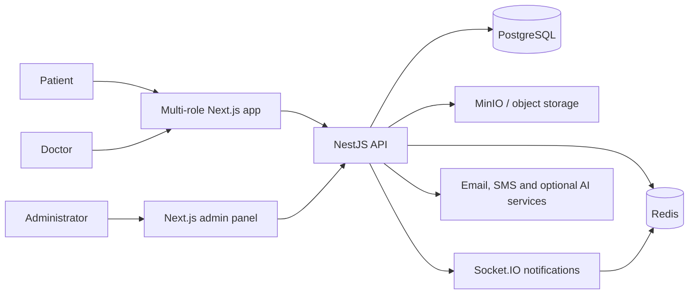

# Rehub Engineering Showcase

> A portfolio-safe technical case study of a multi-role rehabilitation management platform for patients, doctors, and administrators.

[Русская версия](README.ru.md)

[](https://www.typescriptlang.org/)
[](https://nextjs.org/)
[](https://nestjs.com/)
[](https://www.postgresql.org/)
[](https://redis.io/)
[](https://github.com/RaysAndreyRU/rehub-showcase/actions/workflows/quality.yml)

## Why this repository exists

Rehub was created as a graduation project and later expanded into a broad rehabilitation platform. Its product repositories remain private because they contain the complete implementation, environment configuration, integration contracts, and detailed medical workflows.

This repository makes the engineering work reviewable without publishing the product source. It contains:

- a system architecture map;
- patient, doctor, and administrator user flows;
- focused case studies based on implemented behavior;
- a compact runnable TypeScript example of login auditing and temporary IP blocking;
- security, testing, and delivery notes;
- explicit boundaries between implemented capabilities and simplified showcase code.

The sample under `src/` is an original, reduced reference implementation. It is not copied from the private repositories and contains no credentials, personal data, production schema, medical records, or proprietary deployment configuration.

## Product overview

Rehub coordinates the rehabilitation lifecycle across three roles:

- patients follow assigned programs, complete exercises, keep a diary, and review progress;
- doctors manage patients, assign programs, inspect diaries and progress, and prepare reports;
- administrators maintain clinical catalogs, program templates, risk rules, recommendations, reports, analytics, and security operations.

The product surface is split across a multi-role Next.js application, a dedicated administrative panel, a modular NestJS backend, and separate business and technical documentation.

## System architecture



The backend is organized around domain modules and a controller → service → repository → Prisma request path. The admin frontend uses runtime Zod contracts and a `schemas → services → queries → pages` flow. The main web application uses pragmatic route and service boundaries; this showcase intentionally does not label it as Feature-Sliced Design.

Read the full [architecture overview](docs/architecture.md) and [role-oriented user flows](docs/user-flows.md).

## Architecture deep dives

| Case study | Engineering focus |
| --- | --- |
| [Role-oriented platform boundaries](docs/case-studies/01-role-oriented-platform.md) | One domain model exposed through patient, doctor, and administrator workflows. |
| [Rehabilitation program lifecycle](docs/case-studies/02-rehabilitation-program-lifecycle.md) | Templates, assignments, planned and performed sessions, and progress. |
| [Diary and progress projections](docs/case-studies/03-diary-and-progress.md) | Turning exercise facts and patient observations into doctor-facing context. |
| [Clinical policies and event lifecycles](docs/case-studies/04-clinical-policies.md) | Red-flag and recommendation configuration without presenting software as a diagnosis engine. |
| [Login audit and IP throttling](docs/case-studies/05-login-audit-and-ip-throttling.md) | Durable security events combined with expiring Redis counters. |
| [Reports, exports, and side effects](docs/case-studies/06-reports-and-exports.md) | Report lifecycle, PDF data, attachments, email delivery, and notifications. |
| [Contract-first mock-to-API migration](docs/case-studies/07-contract-first-frontend.md) | Zod contracts, React Query, MSW, and incremental backend integration. |
| [Redis-backed realtime notifications](docs/case-studies/08-realtime-notifications.md) | Authenticated sockets, per-user connections, acknowledgements, and horizontal scale. |

Start with the [case study index](docs/case-studies/README.md).

## Public vertical slice

The runnable sample reconstructs the login-security boundary using ports instead of production infrastructure:

```text
src/login-security/
├── adapters/in-memory-security.adapters.ts
├── application/record-login-outcome.use-case.ts
├── domain/login-security.types.ts
└── ports/
    ├── login-attempts.port.ts
    └── security-audit.port.ts
```

It demonstrates:

- durable audit intent for successful and failed logins;
- a separate expiring store for counters and temporary blocks;
- threshold and TTL behavior;
- reset after successful authentication;
- dependency inversion and behavior-focused tests;
- a contract that can be backed by PostgreSQL and Redis without coupling the use case to either technology.

The production implementation uses NestJS guards/services, Prisma-backed security logs, and Redis-backed attempt state. Exact schema, keys, endpoints, and configuration are intentionally omitted.

## Run the sample

Requirements: Node.js 22 and npm.

```bash
npm ci
npm run check
```

| Command | Purpose |
| --- | --- |
| `npm test` | Run behavior tests with Vitest. |
| `npm run test:coverage` | Run tests and enforce coverage thresholds. |
| `npm run typecheck` | Check strict TypeScript contracts. |
| `npm run check` | Run the complete local quality gate. |

## Technology map

| Area | Technologies |
| --- | --- |
| Main application | Next.js, React, TypeScript, React Query, Zod, NextAuth |
| Admin panel | Next.js, React, TypeScript, React Query, React Hook Form, Zod, MSW |
| Backend | NestJS, Prisma, PostgreSQL, Redis, Socket.IO |
| Storage and output | MinIO-compatible storage, React PDF, spreadsheet exports |
| Delivery | Docker, GitHub Actions |
| Public sample | TypeScript, Vitest |

## Disclosure boundary

Not published here:

- production source code or database schema;
- patient, doctor, or administrator data;
- credentials, environment files, hostnames, or deployment manifests;
- exact permission matrices and integration configuration;
- medical content that could be interpreted as treatment guidance;
- private API payloads beyond deliberately simplified examples.

See [security and disclosure notes](docs/security.md).

## Project context

This is a portfolio case study, not a medical device and not a deployable healthcare product. It documents engineering decisions, implemented workflows, and known trade-offs from a graduation project that continued to evolve after its initial delivery.
