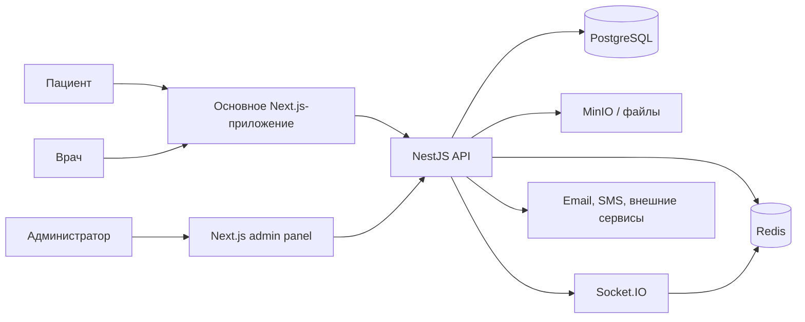

# Rehub — инженерная витрина

> Безопасный для публичного портфолио технический разбор платформы управления реабилитацией для пациентов, врачей и администраторов.

[English version](README.md)

## Зачем нужен этот репозиторий

Rehub начинался как дипломный проект, а затем вырос в большую платформу с пациентским, врачебным и административным контурами. Полные репозитории остаются приватными: в них находятся исходный код продукта, конфигурация окружений, интеграционные контракты и детализированные медицинские сценарии.

Эта витрина позволяет оценить инженерную работу, не публикуя приватный продукт. Здесь находятся:

- обзор системной архитектуры;
- user flow для трёх ролей;
- разборы реально реализованных технических решений;
- небольшой запускаемый TypeScript-пример аудита входов и временной блокировки IP;
- описание security-, testing- и delivery-подходов;
- явное разделение между production-реализацией и упрощённым демонстрационным кодом.

Код в `src/` написан специально для витрины. Он не скопирован из приватных репозиториев и не содержит персональных данных, секретов, production-схемы БД или медицинских записей.

## Что делает система

- Пациент получает программу, выполняет упражнения, ведёт дневник и отслеживает прогресс.
- Врач ведёт пациентов, назначает программы, анализирует дневники и динамику, готовит отчёты.
- Администратор управляет справочниками, упражнениями, шаблонами программ, правилами рисков, рекомендациями, аналитикой, отчётами и безопасностью.

Система разделена на многоролевое Next.js-приложение, отдельную административную панель, доменно-модульный NestJS backend и самостоятельную документацию.

## Архитектура



Backend разделён по доменам и использует путь `controller → service → repository → Prisma`. В admin-приложении применяется цепочка `schemas → services → queries → pages` с Zod-контрактами. Основное web-приложение имеет прагматичную гибридную структуру; витрина намеренно не называет её FSD.

Подробнее: [архитектура](docs/architecture.md), [user flows](docs/user-flows.md), [технические кейсы](docs/case-studies/README.md).

## Главные технические кейсы

1. Ролевые границы пациентского, врачебного и административного контуров.
2. Жизненный цикл реабилитационной программы: шаблон → назначение → плановые и выполненные сессии → прогресс.
3. Дневник пациента и формирование контекста для врача.
4. Правила red flags и рекомендаций с отдельным жизненным циклом событий.
5. Аудит входов, Redis-счётчики попыток и временная блокировка IP.
6. Отчёты, подготовка данных для PDF, вложения, экспорт, email и уведомления.
7. Переход frontend с MSW-моков на реальный API без замены UI-контрактов.
8. Авторизованные realtime-уведомления через Socket.IO и Redis adapter.

## Публичные примеры кода

В `src/` находятся три запускаемых и покрытых тестами vertical slice:

- `login-security` — аудит входов, счётчики попыток, TTL-блокировка и сброс после успешного входа;
- `red-flag-engine` — проверка активных правил по последнему измерению в заданном временном окне, шесть операторов сравнения и cooldown;
- `notifications` — сначала надёжное сохранение уведомления, затем best-effort доставка через realtime-транспорт.

Red-flag evaluator — безопасная reference-реализация опубликованной модели правил, а не копия приватного production-кода. Notification sample демонстрирует реальную архитектурную гарантию: сбой Socket.IO не отменяет уже сохранённое уведомление.

## Запуск примера

Нужны Node.js 22 и npm.

```bash
npm ci
npm run check
```

## Честные ограничения

Это инженерная витрина дипломного и pet-проекта, а не медицинское устройство и не готовый к развёртыванию healthcare-продукт. Автотесты в приватных частях системы развиты неравномерно, а основное web-приложение содержит накопленный архитектурный долг. Витрина показывает сильные реализованные решения, не скрывая происхождение и ограничения проекта.
