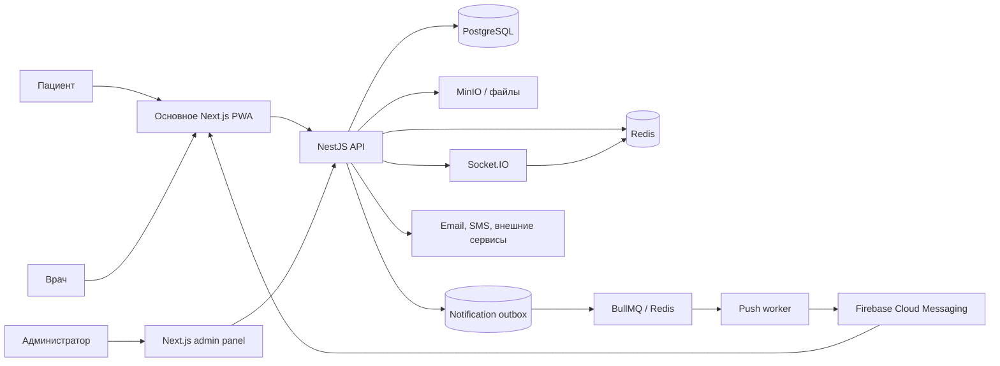

# Rehub — инженерная витрина

> Безопасный для публичного портфолио технический разбор платформы управления реабилитацией для пациентов, врачей и администраторов.

[English version](README.md)

## Зачем нужен этот репозиторий

Rehub начинался как дипломный проект, а затем вырос в большую платформу с пациентским, врачебным и административным контурами. Полные репозитории остаются приватными: в них находятся исходный код продукта, конфигурация окружений, интеграционные контракты и детализированные медицинские сценарии.

Эта витрина позволяет оценить инженерную работу, не публикуя приватный продукт. Здесь находятся:

- обзор системной архитектуры;
- user flow для трёх ролей;
- разборы реально реализованных технических решений;
- небольшой запускаемый TypeScript-пример аудита входов и временной блокировки IP;
- описание security-, testing- и delivery-подходов;
- явное разделение между production-реализацией и упрощённым демонстрационным кодом.

Код в `src/` написан специально для витрины. Он не скопирован из приватных репозиториев и не содержит персональных данных, секретов, production-схемы БД или медицинских записей.

## Что делает система

- Пациент получает программу, выполняет упражнения, ведёт дневник и отслеживает прогресс.
- Врач ведёт пациентов, назначает программы, анализирует дневники и динамику, готовит отчёты.
- Администратор управляет справочниками, упражнениями, шаблонами программ, правилами рисков, рекомендациями, аналитикой, отчётами и безопасностью.

Система разделена на многоролевое Next.js PWA, отдельную административную панель, доменно-модульный NestJS backend и самостоятельную документацию.

## Архитектура



Backend разделён по доменам и использует путь `controller → service → repository → Prisma`. В admin-приложении применяется цепочка `schemas → services → queries → pages` с Zod-контрактами. Основное web-приложение имеет прагматичную гибридную структуру; витрина намеренно не называет её FSD.

Подробнее: [архитектура](docs/architecture.md), [user flows](docs/user-flows.md), [технические кейсы](docs/case-studies/README.md).

## Главные технические кейсы

1. [Ролевые границы платформы](docs/case-studies/01-role-oriented-platform.ru.md) ([EN](docs/case-studies/01-role-oriented-platform.md)).
2. [Жизненный цикл реабилитационной программы](docs/case-studies/02-rehabilitation-program-lifecycle.ru.md) ([EN](docs/case-studies/02-rehabilitation-program-lifecycle.md)).
3. [Дневник и проекции прогресса](docs/case-studies/03-diary-and-progress.ru.md) ([EN](docs/case-studies/03-diary-and-progress.md)).
4. [Клинические политики и жизненный цикл событий](docs/case-studies/04-clinical-policies.ru.md) ([EN](docs/case-studies/04-clinical-policies.md)).
5. [Аудит входов и временное ограничение по IP](docs/case-studies/05-login-audit-and-ip-throttling.ru.md) ([EN](docs/case-studies/05-login-audit-and-ip-throttling.md)).
6. [Отчёты, экспорт и внешние эффекты](docs/case-studies/06-reports-and-exports.ru.md) ([EN](docs/case-studies/06-reports-and-exports.md)).
7. [Contract-first переход от mock к API](docs/case-studies/07-contract-first-frontend.ru.md) ([EN](docs/case-studies/07-contract-first-frontend.md)).
8. [Realtime-уведомления на Redis](docs/case-studies/08-realtime-notifications.ru.md) ([EN](docs/case-studies/08-realtime-notifications.md)).
9. [Надёжная транзакционная push-доставка](docs/case-studies/09-transactional-push-delivery.ru.md) через outbox, BullMQ и Firebase с повтором только временно упавших устройств.
10. [PWA и Web Push с учётом приватности](docs/case-studies/10-privacy-aware-pwa.ru.md): единый service worker, безопасная граница кэша, явное разрешение и дедупликация push.
11. [Сопровождение brownfield-системы и безопасные миграции](docs/case-studies/11-brownfield-maintenance-and-safe-migrations.ru.md): cross-surface совместимость, expand–migrate–contract rollout, backfills, recovery и явные ограничения модернизации.
12. [Production quality gates](docs/case-studies/12-production-quality-gates.ru.md) ([EN](docs/case-studies/12-production-quality-gates.md)): проверка миграций backend, браузерные тесты frontend, диагностические артефакты и публикация Docker-образов только после зелёных проверок.

Все разборы доступны на русском и английском языках; переключатель языка расположен в начале каждого документа.

## Публичные примеры кода

В `src/` находятся три запускаемых и покрытых тестами vertical slice:

- `login-security` — аудит входов, счётчики попыток, TTL-блокировка и сброс после успешного входа;
- `red-flag-engine` — проверка активных правил по последнему измерению в заданном временном окне, шесть операторов сравнения и cooldown;
- `notifications` — сначала надёжное сохранение уведомления, затем best-effort доставка через realtime-транспорт.

Red-flag evaluator — безопасная reference-реализация опубликованной модели правил, а не копия приватного production-кода. Notification sample демонстрирует реальную архитектурную гарантию: сбой Socket.IO не отменяет уже сохранённое уведомление.

## Запуск примера

Нужны Node.js 22 и npm.

```bash
npm ci
npm run check
```

## Проверяемые тесты и delivery pipeline

Для каждого развёртываемого репозитория настроен GitHub Actions pipeline. Backend применяет всю историю Prisma-миграций к чистому PostgreSQL до сборки образов API, миграций и Prisma Studio. Основное web- и admin-приложения проходят typecheck, unit/contract-тесты, production build и Playwright E2E до публикации stage- или production-образов.

Снимок, проверенный 26 октября 2026 года:

| Контур | Автоматизированные проверки | Условие публикации |
| --- | --- | --- |
| Backend | 73 теста в 29 suites и migration smoke test на чистой БД | Образы API, миграций и Prisma Studio зависят от quality- и migration-job. |
| Основной web | 43 unit/contract-теста и 7 Chromium E2E-сценариев | Stage- и production-образы зависят от quality- и E2E-job. |
| Admin | 16 unit-тестов и 5 Chromium E2E-сценариев | Stage- и production-образы зависят от quality- и E2E-job. |

При сбоях браузерные job сохраняют JUnit, HTML-отчёт, trace, screenshots и video. Числа выше — датированный снимок проверяемых сценариев, а не заявление о полном покрытии платформы. Подробности: [Testing and Delivery](docs/testing.md) и [разбор production pipeline](docs/case-studies/12-production-quality-gates.ru.md).

## Честные ограничения

Это инженерная витрина дипломного и pet-проекта, а не медицинское устройство и не готовый к развёртыванию healthcare-продукт. Глубина тестирования по модулям всё ещё различается, а основное web-приложение содержит накопленный архитектурный долг. При этом у каждого развёртываемого репозитория теперь есть автоматизированный quality gate. Витрина показывает сильные реализованные решения, не скрывая происхождение и ограничения проекта.
