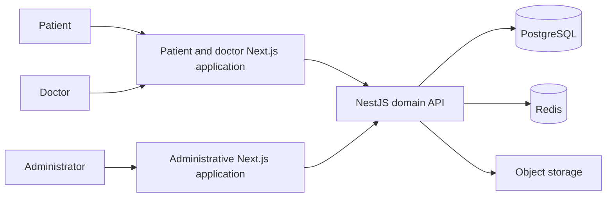
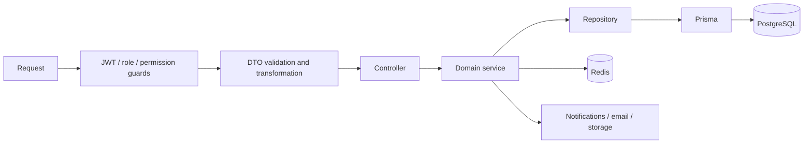
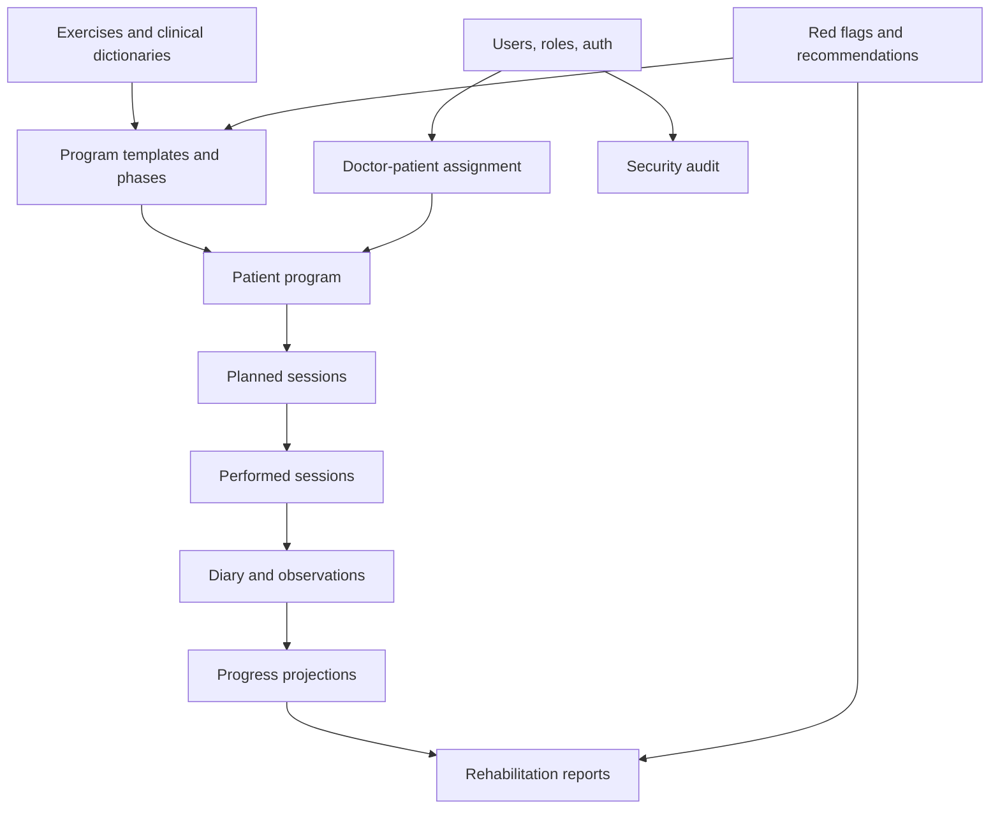

# Architecture Overview

## System context

Rehub uses one backend domain model to support three different operational views. Patients interact with assignments and daily execution, doctors work with clinical context and adjustment, and administrators maintain catalogs, rules, reports, and platform operations.

## Backend request path

Controllers bind transport contracts, services coordinate business scenarios, and repositories isolate query composition. Cross-cutting filters and interceptors normalize validation, successful responses, and errors.

## Product decomposition

| Surface | Responsibility | Architectural character |
| --- | --- | --- |
| Main web | Patient and doctor journeys plus public content | Pragmatic Next.js App Router application with shared services and route groups. |
| Admin | Catalogs, rules, reports, analytics, security | Layered frontend with schemas, services, React Query hooks, pages, and MSW handlers. |
| Backend | Domain behavior and integrations | Modular NestJS application with services and repositories around Prisma. |
| Docs | Business processes and technical contracts | Role, domain, route, sequence, and data-model documentation. |

This distinction is deliberate. The product is not presented as one uniform frontend architecture, and the main application is not described as FSD.

## Domain map

## Data and state ownership

- PostgreSQL stores durable domain state and audit records.
- Redis stores expiring login-attempt state, socket connection sets, presence coordination, and cross-instance realtime transport.
- Object storage holds file and media payloads while relational records retain metadata and ownership.
- React Query owns remote frontend cache; form state remains local to the relevant UI boundary.
- MSW provides deterministic domain responses for admin screens that have not yet moved to live endpoints.

## Known trade-offs

- The backend grew from a graduation project and contains both newer domain modules and older integration surfaces.
- The main web application has large route components and mixed legacy/new boundaries.
- Backend integration progressed incrementally, so mock and live data paths coexist in parts of the frontends.
- Automated test depth is uneven across repositories; the public sample has its own strict, small quality gate.
