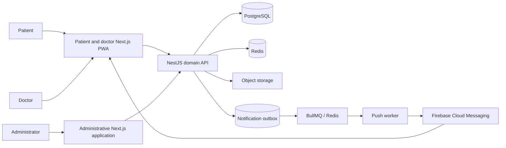
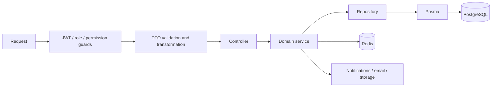
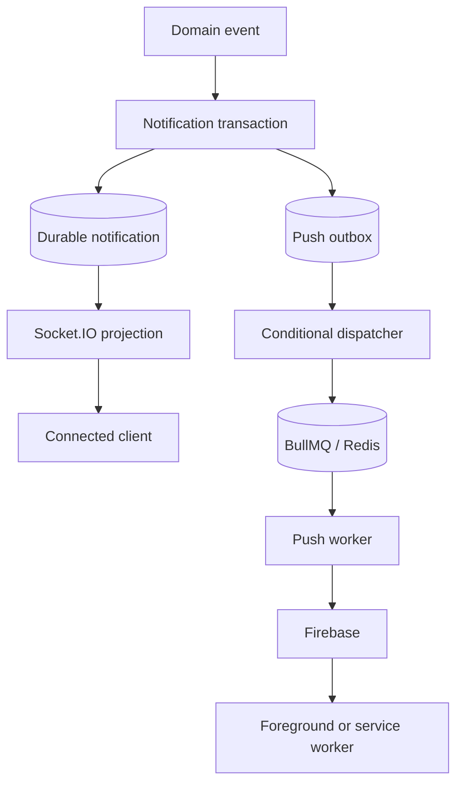
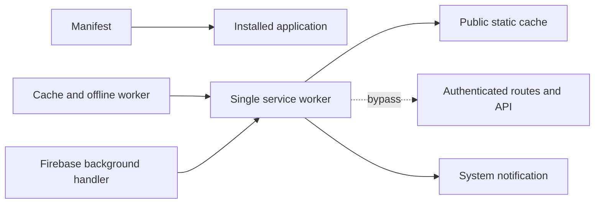
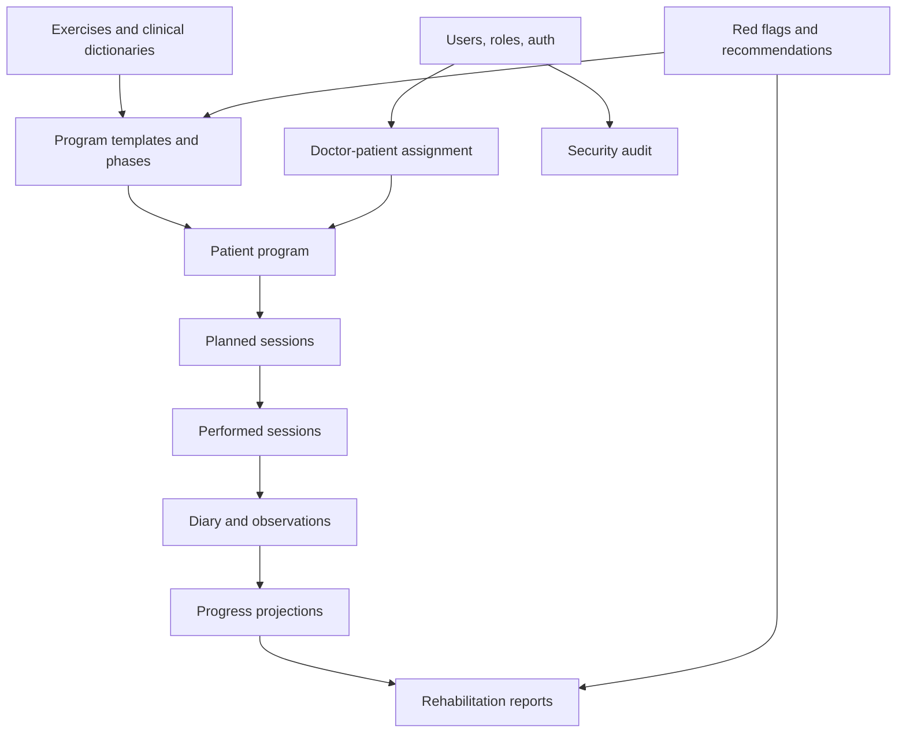

# Architecture Overview

## System context

Rehub uses one backend domain model to support three different operational views. Patients interact with assignments and daily execution, doctors work with clinical context and adjustment, and administrators maintain catalogs, rules, reports, and platform operations.

## Backend request path

Controllers bind transport contracts, services coordinate business scenarios, and repositories isolate query composition. Cross-cutting filters and interceptors normalize validation, successful responses, and errors.

## Product decomposition

| Surface | Responsibility | Architectural character |
| --- | --- | --- |
| Main web | Patient and doctor journeys plus public content | Pragmatic installable Next.js PWA with shared services, route groups, and one service worker. |
| Admin | Catalogs, rules, reports, analytics, security | Layered frontend with schemas, services, React Query hooks, pages, and MSW handlers. |
| Backend | Domain behavior and integrations | Modular NestJS application with services and repositories around Prisma. |
| Docs | Business processes and technical contracts | Role, domain, route, sequence, and data-model documentation. |

## Notification delivery planes

Realtime and push solve related but different delivery problems. Socket.IO provides low-latency projection while a session is connected. Push uses a transactional outbox because delivery intent must survive API, Redis, worker, and provider failures.

The durable list remains the recovery interface for both channels. Neither a socket event nor a provider acknowledgement proves that a person read or acted on the notification.

## PWA boundary

The worker caches public shell assets and an offline fallback while bypassing authenticated routes, API requests, and responses marked private or non-cacheable. Firebase messaging is composed into the same worker so only one process controls the application scope.

This distinction is deliberate. The product is not presented as one uniform frontend architecture, and the main application is not described as FSD.

## Domain map

## Data and state ownership

- PostgreSQL stores durable domain state and audit records.
- Redis stores expiring login-attempt state, socket connection sets, cross-instance realtime transport, and BullMQ queue data. PostgreSQL outbox state remains the durable source for push recovery.
- Object storage holds file and media payloads while relational records retain metadata and ownership.
- React Query owns remote frontend cache; form state remains local to the relevant UI boundary.
- MSW provides deterministic domain responses for admin screens that have not yet moved to live endpoints.

## Known trade-offs

- The backend grew from a graduation project and contains both newer domain modules and older integration surfaces.
- The main web application has large route components and mixed legacy/new boundaries.
- Backend integration progressed incrementally, so mock and live data paths coexist in parts of the frontends.
- Test depth still varies by module, but every deployable repository now has an automated quality gate; both frontends include browser-level critical-path coverage, and the backend validates migrations against a clean database.
- Push processing is at-least-once: generation and lease controls prevent stale completion, while frontend delivery keys reduce duplicate presentation.

Related deep dives: transactional push delivery ([EN](case-studies/09-transactional-push-delivery.md) · [RU](case-studies/09-transactional-push-delivery.ru.md)), privacy-aware PWA ([EN](case-studies/10-privacy-aware-pwa.md) · [RU](case-studies/10-privacy-aware-pwa.ru.md)), and production quality gates ([EN](case-studies/12-production-quality-gates.md) · [RU](case-studies/12-production-quality-gates.ru.md)).
