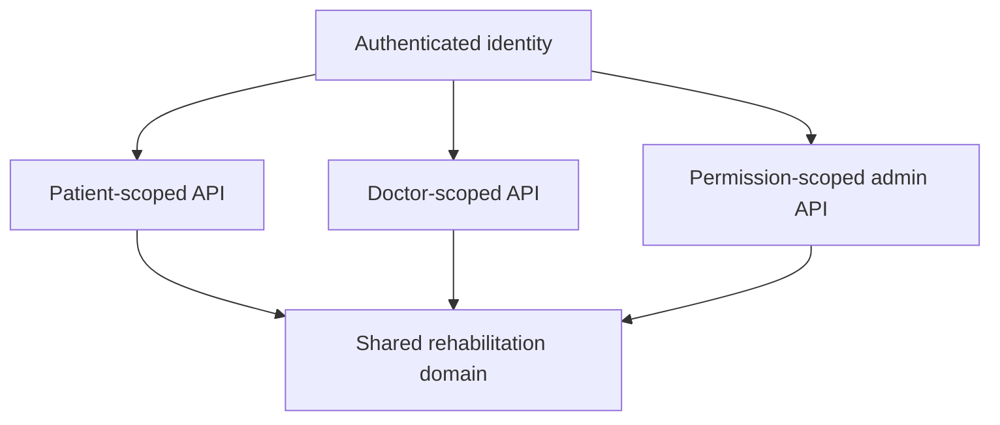

# Case Study: Role-oriented Platform Boundaries

## Problem

A rehabilitation platform exposes the same underlying treatment process differently to patients, doctors, and administrators. A single screen model would either leak privileged operations or force every client to understand the entire domain.

## Implemented approach

Rehub separates user-facing surfaces while retaining one backend domain model:

- the patient reads assigned programs, exercise details, diary history, and progress;
- the doctor manages related patients, assignments, exercise state, diaries, requests, and reports;
- the administrator maintains users, dictionaries, templates, policies, analytics, security operations, and reporting.

Backend guards enforce role and permission requirements. Actor-specific services and repositories scope queries to the authenticated user and their relations rather than relying on frontend navigation as access control.

## Why separate applications

The main web application optimizes daily patient and doctor journeys. The admin panel has denser tables, dictionaries, rule editors, reports, and operational tools. Separating them allows different navigation and release concerns without duplicating backend ownership.

## Trade-offs

- Shared concepts can drift between clients when contracts are maintained manually.
- The main web repository accumulated mixed legacy and newer modules.
- Authorization must be repeated at every backend entry point even when the UI already hides an action.

## Engineering signal

The interesting part is not three menus; it is the separation of presentation scope from backend authorization scope around one relational domain.
