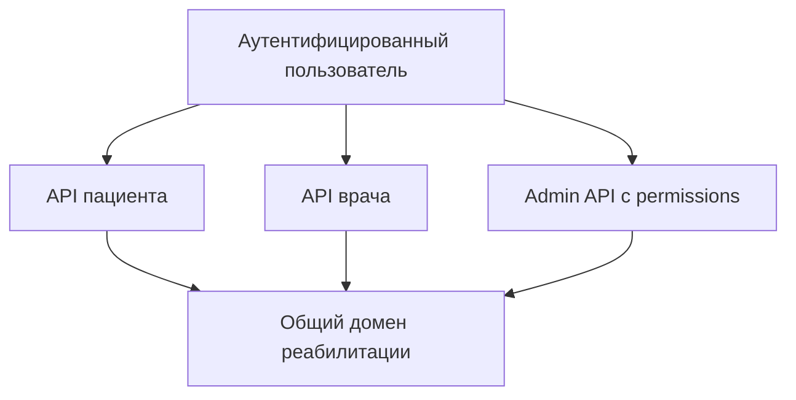

# Кейс: ролевые границы платформы

[English](01-role-oriented-platform.md) | [Русский]

## Проблема

Один процесс реабилитации выглядит по-разному для пациента, врача и администратора. Единая экранная модель либо раскрывала бы привилегированные операции, либо заставляла бы каждый клиент понимать весь домен.

## Реализованный подход

Rehub разделяет пользовательские контуры, сохраняя одну backend-модель:

- пациент просматривает назначенные программы, упражнения, дневник и прогресс;
- врач управляет связанными пациентами, назначениями, упражнениями, дневниками, запросами и отчётами;
- администратор ведёт пользователей, справочники, шаблоны, политики, аналитику, безопасность и отчётность.

Backend guards проверяют роли и permissions. Actor-specific services и repositories ограничивают запросы текущим пользователем и его связями, не полагаясь на скрытую навигацию frontend.

## Почему приложения разделены

Основное web-приложение оптимизировано под ежедневные сценарии пациента и врача. Admin panel содержит плотные таблицы, справочники, редакторы правил, отчёты и операционные инструменты. Разделение даёт разную навигацию и release cadence без дублирования backend ownership.

## Компромиссы

- Общие понятия могут расходиться между клиентами при ручном ведении контрактов.
- В main web накопилась смесь legacy- и новых модулей.
- Авторизацию нужно повторять в каждой backend-точке входа, даже если UI скрывает действие.

## Инженерный результат

Суть решения не в трёх меню, а в разделении presentation scope и backend authorization scope вокруг одного реляционного домена.
