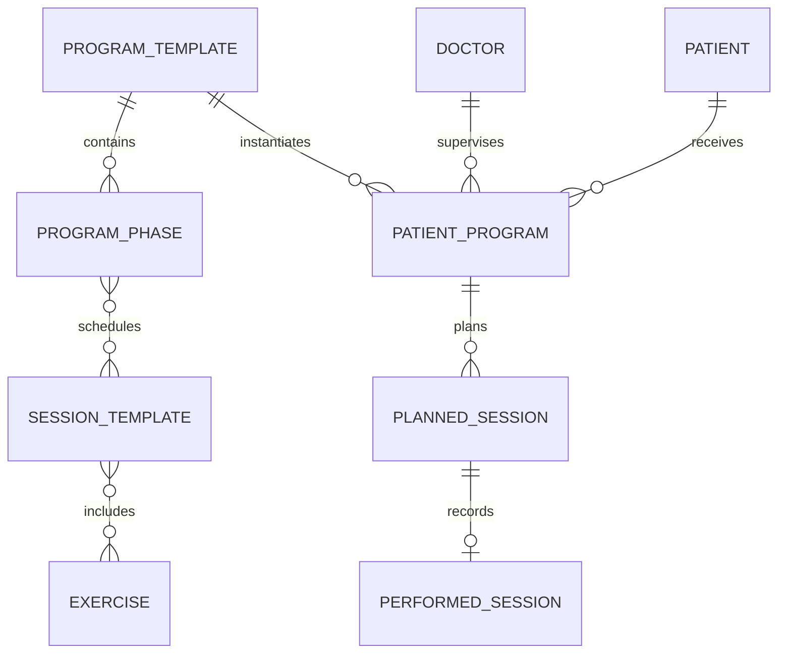

# Case Study: Rehabilitation Program Lifecycle

[English] | [Русский](02-rehabilitation-program-lifecycle.ru.md)

## Problem

A reusable clinical program is not the same entity as the program a particular patient executes. Templates need phases and exercise policies, while assignments need dates, statuses, planned sessions, performed facts, and patient-specific state.

## Implemented model

Templates contain condition, duration, progression strategy, phases, goals, restrictions, session templates, exercise overrides, and linked clinical policies. Assignment materializes a patient/doctor/template relation with its own lifecycle.

Representative statuses are `PLANNED`, `ACTIVE`, `PAUSED`, `COMPLETED`, and `CANCELLED`. Planned and performed sessions remain separate so missed, rescheduled, and completed work can be analyzed without rewriting the plan.

## Progress boundary

Adherence is derived from plan-versus-fact data rather than stored as the only source of truth. Exercise-level state can evolve independently from the overall assignment.

## Trade-offs

- Rich template composition increases query and DTO complexity.
- Updating a template must not silently mutate the historical meaning of an existing assignment.
- Status validation exists across several operational surfaces and benefits from stronger centralized transition rules.

## Engineering signal

The design distinguishes reusable clinical intent, patient-specific assignment, scheduled work, and execution facts—four concepts that are often incorrectly collapsed into one table.
