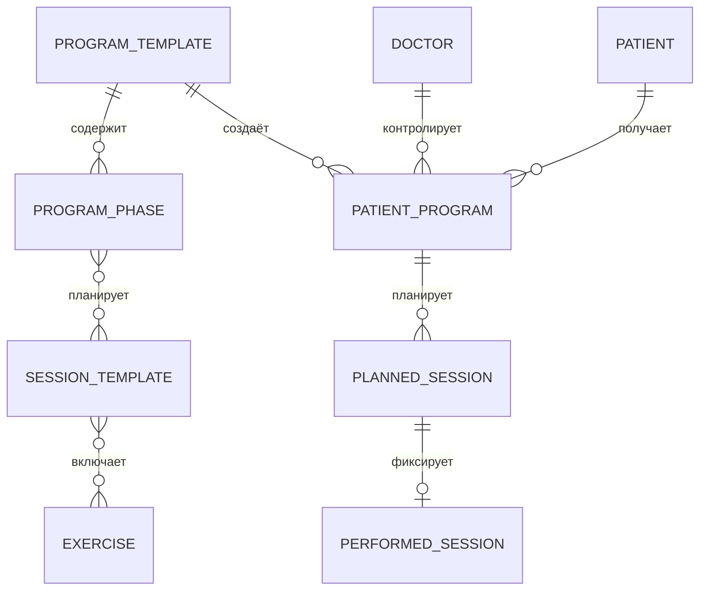

# Кейс: жизненный цикл реабилитационной программы

[English](02-rehabilitation-program-lifecycle.md) | [Русский]

## Проблема

Переиспользуемая клиническая программа — не то же самое, что программа конкретного пациента. Шаблону нужны фазы и политики упражнений, а назначению — даты, статусы, плановые сессии, фактическое выполнение и состояние пациента.

## Реализованная модель

Шаблон содержит состояние, длительность, стратегию прогрессии, фазы, цели, ограничения, session templates, overrides упражнений и связанные клинические политики. Назначение материализует связь пациент/врач/шаблон со своим lifecycle.

Типичные статусы: `PLANNED`, `ACTIVE`, `PAUSED`, `COMPLETED`, `CANCELLED`. План и факт разделены, поэтому пропуски, переносы и выполнение анализируются без перезаписи исходного плана.

## Граница прогресса

Adherence вычисляется из plan-versus-fact, а не хранится как единственный источник истины. Состояние отдельного упражнения развивается независимо от назначения целиком.

## Компромиссы

- Богатая композиция шаблона усложняет queries и DTO.
- Обновление шаблона не должно менять исторический смысл существующего назначения.
- Проверки переходов статуса распределены по нескольким контурам и требуют более централизованных правил.

## Инженерный результат

Модель разделяет клинический замысел, назначение пациенту, запланированную работу и факты выполнения — четыре сущности, которые часто ошибочно объединяют в одну таблицу.
