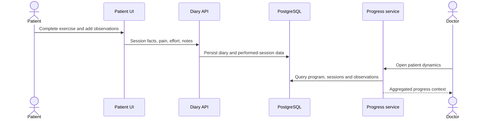

# Case Study: Diary and Progress Projections

[English] | [Русский](03-diary-and-progress.ru.md)

## Problem

Exercise completion alone does not tell a doctor how a patient responded. Rehabilitation review also needs pain, perceived effort, range-of-motion context, observations, missed sessions, and trends over time.

## Implemented flow

The patient-facing flow records daily execution and observations. Doctor views combine those facts with program and exercise context instead of exposing raw rows. Progress summaries feed later review and reporting scenarios.

## Boundary choice

The diary remains a durable clinical observation stream, while progress is a read-oriented projection. This prevents charts and summary cards from becoming the source of truth.

## Trade-offs

- Projection rules must handle sparse and partially completed data.
- Large service and repository methods grew as the patient flow expanded.
- Clinical metrics require careful naming so a UI trend is not mistaken for a diagnosis.

## Engineering signal

This case demonstrates plan-versus-fact modeling and the separation of durable observations from derived presentation models.
