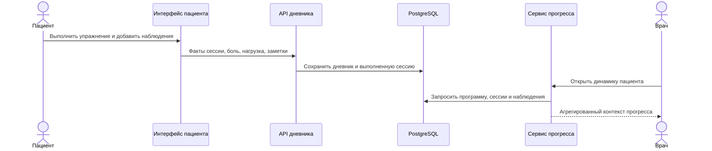

# Кейс: дневник и проекции прогресса

[English](03-diary-and-progress.md) | [Русский]

## Проблема

Факт выполнения упражнения не показывает реакцию пациента. Для обзора врачу нужны боль, субъективная нагрузка, амплитуда движения, наблюдения, пропуски и динамика во времени.

## Реализованный поток

Пациентский сценарий сохраняет ежедневное выполнение и наблюдения. Представление врача объединяет эти факты с контекстом программы и упражнений вместо выдачи сырых строк. Сводки затем используются в review и reporting.

## Выбор границы

Дневник остаётся долговечным потоком клинических наблюдений, а прогресс — read-oriented projection. Графики и summary cards не становятся источником истины.

## Компромиссы

- Проекции должны корректно обрабатывать разреженные и частично заполненные данные.
- С ростом пациентского сценария увеличились некоторые services и repositories.
- Клинические метрики требуют точных названий, чтобы UI-тренд не воспринимался как диагноз.

## Инженерный результат

Кейс показывает plan-versus-fact modeling и отделение долговечных наблюдений от производных presentation models.
