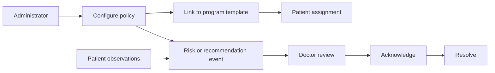
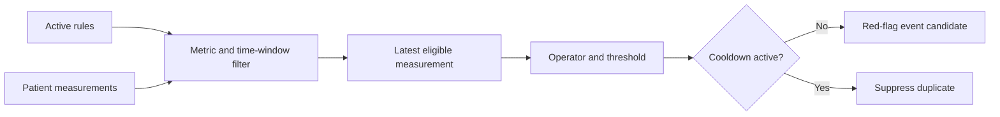

# Case Study: Clinical Policies and Event Lifecycles

[English] | [Русский](04-clinical-policies.ru.md)

## Problem

Administrators need to maintain risk and recommendation policies without hardcoding every threshold in UI components. Doctors need events they can acknowledge and resolve, not an opaque binary alert.

## Implemented approach

Red-flag rules model a metric key, comparison operator, threshold, observation window, cooldown, severity, recommendation text, and optional automatic action. Recommendation rules have their own priority, source, channels, status, and event records. Program templates can link policies to the rehabilitation context.

Rules and events are deliberately separate. A rule can be edited or disabled, while each event preserves the operational record of what required attention.

## Public reference evaluator

The runnable `src/red-flag-engine` slice makes the rule semantics reviewable without publishing private services or medical data. It:

1. selects active rules;
2. finds the latest patient measurement for the configured metric inside the observation window;
3. applies `GT`, `GTE`, `LT`, `LTE`, `EQ`, or `NEQ` deterministically;
4. suppresses a repeated candidate while the rule is in cooldown;
5. returns an event candidate carrying severity, recommendation text, and automatic-action intent.

Using the latest value is an explicit public-sample decision because the rule model does not expose an aggregation strategy. A production rules engine would make `latest`, `average`, `maximum`, or trend aggregation part of a versioned rule contract.

## Safety wording

Rehub presents these events as prioritization and decision-support signals. The showcase does not describe the software as diagnosing a patient or replacing clinical judgment.

## Trade-offs

- The private CRUD and event-history surfaces are implemented more completely than a generalized execution engine; the public evaluator demonstrates one safe interpretation of the rule contract.
- Metric semantics and units must remain consistent across diaries, progress, rules, and reports.
- Threshold changes need versioning if historical explainability becomes a production requirement.

## Engineering signal

The model turns configurable policy into an auditable operational lifecycle rather than a transient frontend warning.
