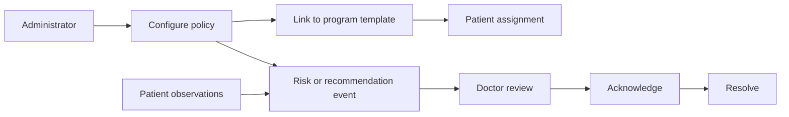

# Case Study: Clinical Policies and Event Lifecycles

## Problem

Administrators need to maintain risk and recommendation policies without hardcoding every threshold in UI components. Doctors need events they can acknowledge and resolve, not an opaque binary alert.

## Implemented approach

Red-flag rules model a metric key, comparison operator, threshold, observation window, cooldown, severity, recommendation text, and optional automatic action. Recommendation rules have their own priority, source, channels, status, and event records. Program templates can link policies to the rehabilitation context.

Rules and events are deliberately separate. A rule can be edited or disabled, while each event preserves the operational record of what required attention.

## Safety wording

Rehub presents these events as prioritization and decision-support signals. The showcase does not describe the software as diagnosing a patient or replacing clinical judgment.

## Trade-offs

- CRUD and event-history surfaces are implemented more completely than a generalized rule-execution engine.
- Metric semantics and units must remain consistent across diaries, progress, rules, and reports.
- Threshold changes need versioning if historical explainability becomes a production requirement.

## Engineering signal

The model turns configurable policy into an auditable operational lifecycle rather than a transient frontend warning.
