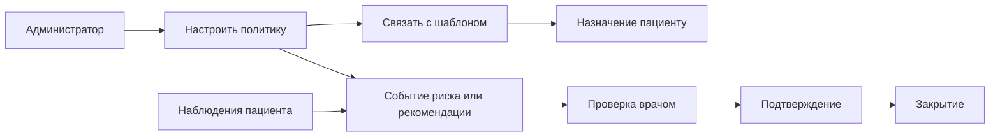

# Кейс: клинические политики и жизненный цикл событий

[English](04-clinical-policies.md) | [Русский]

## Проблема

Администраторам нужно менять правила риска и рекомендаций без hardcode порогов в UI. Врачам нужны события, которые можно подтвердить и закрыть, а не непрозрачный бинарный alert.

## Реализованный подход

Red-flag rule описывает metric key, оператор, threshold, observation window, cooldown, severity, текст рекомендации и необязательное автоматическое действие. У recommendation rules есть priority, source, channels, status и event records. Шаблоны программ связывают политики с контекстом реабилитации.

Правило и событие разделены: правило можно изменить или отключить, а событие сохраняет операционный след того, что требовало внимания.

## Публичный reference evaluator

Запускаемый slice `src/red-flag-engine` показывает семантику без публикации приватных сервисов и медицинских данных. Он выбирает активные правила, находит последнее измерение метрики в окне, детерминированно применяет `GT`, `GTE`, `LT`, `LTE`, `EQ` или `NEQ`, подавляет повтор в cooldown и возвращает event candidate с severity, рекомендацией и intent автоматического действия.

Использование последнего значения — явное решение sample. Production rules engine должен версионированно определять стратегию `latest`, `average`, `maximum` или trend.

## Формулировки безопасности

Rehub описывает события как сигналы приоритизации и поддержки решений, а не как диагностику или замену клинического суждения.

## Компромиссы

- Приватные CRUD и event-history полнее универсального execution engine; публичный evaluator показывает безопасную интерпретацию.
- Семантика и единицы метрик должны совпадать в дневниках, прогрессе, правилах и отчётах.
- Для исторической объяснимости изменения thresholds потребуют versioning.

## Инженерный результат

Конфигурируемая политика превращается в проверяемый operational lifecycle, а не во временное предупреждение frontend.
