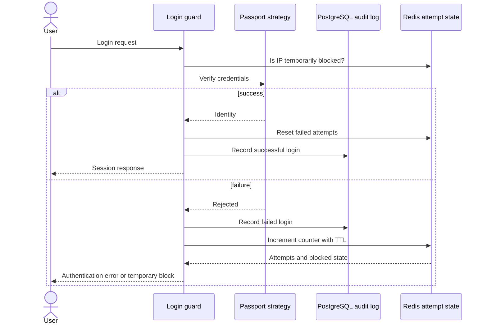

# Case Study: Login Audit and Temporary IP Throttling

## Problem

Authentication needs two different kinds of state: a durable record for investigation and short-lived counters for abuse control. Storing both in one database either makes every login expensive or gives temporary data an unnecessarily long lifetime.

## Implemented approach

The private backend uses a NestJS login guard, a Prisma-backed security-log service, and a Redis-backed failed-attempt service.

The public sample expresses this boundary through two ports:

- `SecurityAuditPort` for durable events;
- `LoginAttemptsPort` for expiring failure and block state.

The real Redis operation increments a per-IP counter, assigns a TTL on first failure, creates a temporary block at the threshold, and clears the counter after successful authentication.

## Design decisions

- Audit data and throttling data have different retention and consistency requirements.
- The attempt key is based on normalized IP rather than user existence, reducing account-enumeration differences.
- A successful login resets stale failures for that source.
- The public port expects counter registration to be atomic even though its in-memory adapter is intentionally simple.

## Trade-offs and hardening

- IP-only throttling can affect users behind a shared NAT and should be combined with broader rate-limit policy in a production system.
- Client IP extraction must trust only configured proxies.
- Audit writes need an explicit availability policy: authentication should not be accidentally taken down by a reporting-only failure, while security events should not be silently lost.
- Redis Lua or a transactional primitive should keep increment, TTL, and block creation atomic under concurrency.

## Engineering signal

This case demonstrates choosing storage by state lifetime, designing security behavior as a state machine, and keeping enforcement separate from audit presentation.
