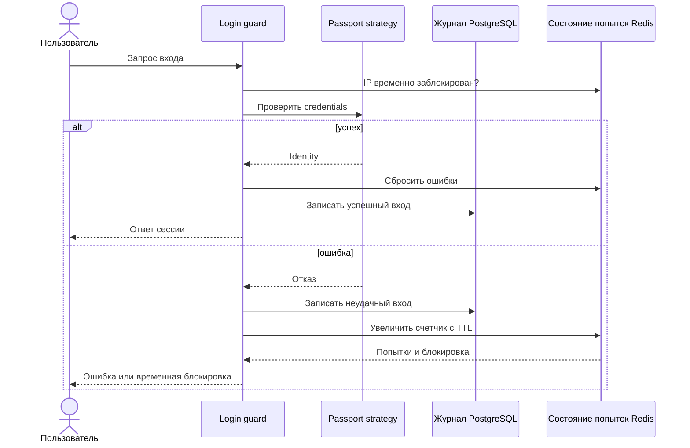

# Кейс: аудит входов и временное ограничение по IP

[English](05-login-audit-and-ip-throttling.md) | [Русский]

## Проблема

Аутентификации нужны два типа состояния: долговечный журнал расследований и короткоживущие счётчики защиты от злоупотреблений. Единое хранилище либо делает каждый вход дорогим, либо сохраняет временные данные слишком долго.

## Реализованный подход

Приватный backend использует NestJS login guard, security log на Prisma и failed-attempt service на Redis.

Публичный sample выражает границу через `SecurityAuditPort` для долговечных событий и `LoginAttemptsPort` для временного состояния. Реальная Redis-операция увеличивает счётчик по IP, задаёт TTL при первой ошибке, создаёт блокировку на пороге и очищает счётчик после успеха.

## Проектные решения

- Audit и throttling имеют разные требования к retention и consistency.
- Ключ основан на нормализованном IP, а не существовании пользователя, снижая различия для account enumeration.
- Успешный вход очищает устаревшие ошибки источника.
- Контракт требует атомарной регистрации, хотя in-memory adapter намеренно прост.

## Компромиссы и усиление

- IP-only throttling затрагивает пользователей за общим NAT и должен дополняться общей rate-limit policy.
- Client IP следует принимать только от настроенных proxies.
- Для audit write нужна явная availability policy: reporting failure не должен случайно отключать вход, но security events нельзя терять молча.
- Redis Lua или transaction должны атомарно объединить increment, TTL и block creation.

## Инженерный результат

Кейс показывает выбор хранилища по lifetime состояния, безопасность как state machine и разделение enforcement от audit presentation.
