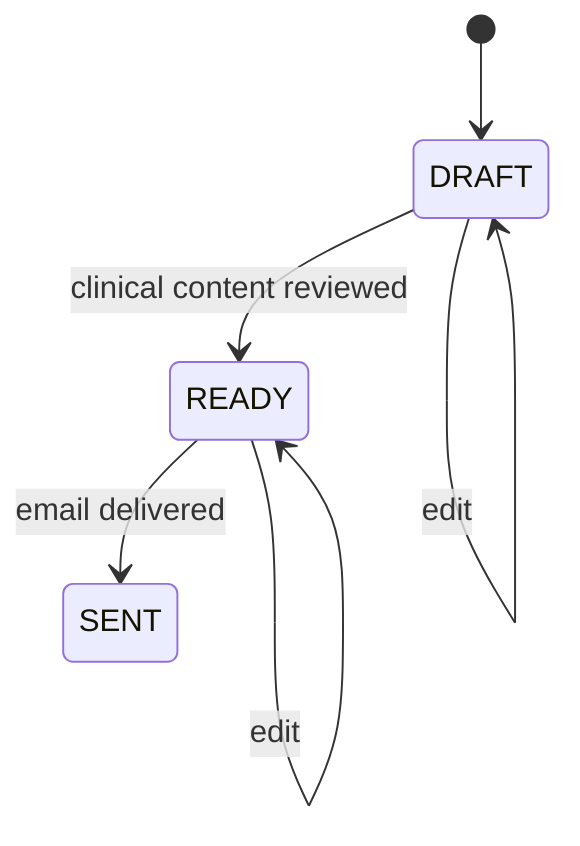

# Case Study: Reports, Exports, and Side Effects

[English] | [Русский](06-reports-and-exports.ru.md)

## Problem

A rehabilitation report is both structured clinical data and a deliverable. It needs relational ownership, editable lifecycle state, attachments, a PDF representation, email delivery, and operational notifications.

## Implemented flow

Reports are linked to a patient and doctor and may reference a patient program. They carry period dates, summary fields, adherence, pain and effort context, policy-event counts, status, matrix rows, and attachments.

The backend returns a structured export model. The admin frontend renders the PDF preview, keeping presentation layout out of the API. Sending a report verifies the recipient, delivers an email containing the report link, updates status, and creates an administrator notification.

Generic export services use discoverable export handlers so domain modules prepare typed rows while a shared boundary handles output format.

## Trade-offs

- Frontend PDF rendering makes visual iteration fast but requires contract coordination.
- A URL supplied for email delivery must be constrained to trusted application origins in a hardened deployment.
- Email success and status persistence form a distributed side effect; retries and idempotency need explicit operational policy.
- Report data is sensitive and requires authorization at both detail and export endpoints.

## Engineering signal

The case connects domain lifecycle, export architecture, frontend document rendering, external delivery, and realtime operational feedback.
