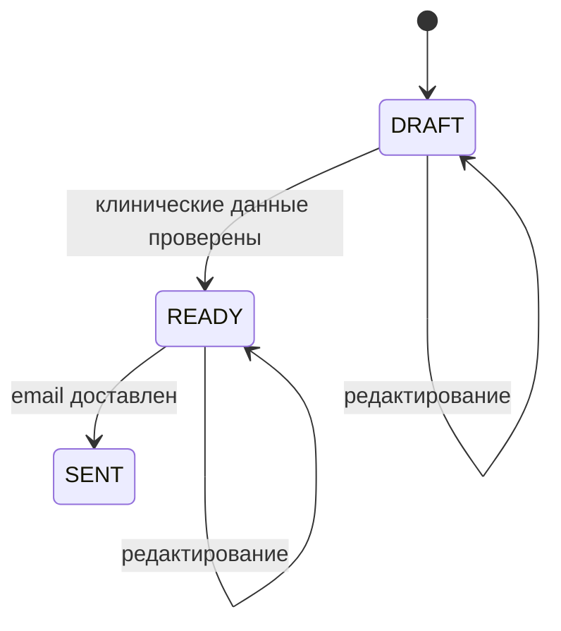

# Кейс: отчёты, экспорт и внешние эффекты

[English](06-reports-and-exports.md) | [Русский]

## Проблема

Реабилитационный отчёт — одновременно структурированные клинические данные и готовый документ. Ему нужны relational ownership, редактируемый lifecycle, attachments, PDF, отправка email и операционные уведомления.

## Реализованный поток

Отчёт связан с пациентом и врачом и может ссылаться на программу. Он содержит период, summary fields, adherence, контекст боли и нагрузки, число policy events, статус, строки матрицы и вложения.

Backend возвращает структурированную export model, а admin frontend формирует PDF preview, сохраняя layout вне API. При отправке проверяется recipient, email получает ссылку, статус обновляется и создаётся admin notification.

Общие export services обнаруживают handlers: доменные модули готовят typed rows, а shared boundary отвечает за формат результата.

## Компромиссы

- Frontend PDF ускоряет визуальные изменения, но требует согласования контрактов.
- URL в email должен быть ограничен доверенными application origins.
- Email delivery и сохранение статуса — распределённый side effect, которому нужны retries и idempotency policy.
- Чувствительные данные требуют авторизации и на detail, и на export endpoints.

## Инженерный результат

Кейс связывает domain lifecycle, export architecture, frontend rendering документа, внешнюю доставку и realtime feedback.
