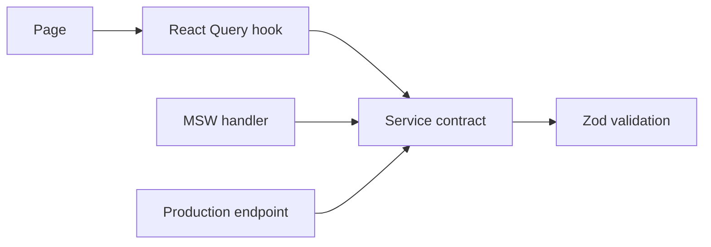

# Case Study: Contract-first Mock-to-API Migration

[English] | [Русский](07-contract-first-frontend.ru.md)

## Problem

The admin product had to progress before every backend endpoint was available. Page-specific mock data would make later integration expensive and allow the mock shape to diverge from the production contract.

## Implemented approach

The admin application follows a stable path:

```text
Zod schema → service boundary → React Query hook → page
                    ↑
              MSW or live API
```



Mock handlers validate input with the same schemas and return the same response shapes expected from production. As backend areas become available, the transport changes while pages and query hooks retain their contract.

This approach is active in domain areas such as exercises, reports, clinical policies, dictionaries, and program-related forms. Form-option endpoints keep statuses and dictionary values out of page components.

## Trade-offs

- Handwritten frontend and backend contracts can still drift without generated OpenAPI clients.
- Maintaining realistic mutable mocks is real engineering work, not free scaffolding.
- During migration, some screens may mix live records with mock catalogs; those boundaries must be visible and temporary.
- The main patient/doctor application does not follow the same clean structure consistently.

## Engineering signal

Mock-first development works here as a replaceable adapter behind runtime contracts, not as hardcoded UI data.
