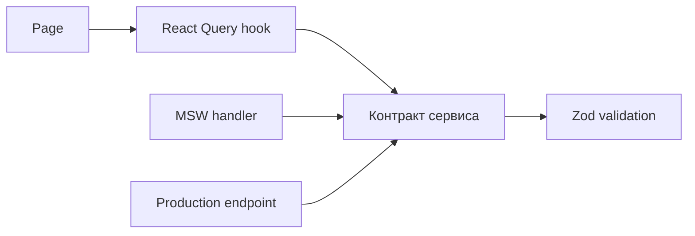

# Кейс: contract-first переход от mock к API

[English](07-contract-first-frontend.md) | [Русский]

## Проблема

Admin-продукт развивался до готовности всех backend endpoints. Page-specific mock data сделали бы интеграцию дорогой и позволили mock shape разойтись с production contract.

## Реализованный подход

Admin application следует стабильной цепочке:

```text
Zod schema → service boundary → React Query hook → page
                    ↑
              MSW или live API
```



Mock handlers проверяют вход теми же schemas и возвращают production-compatible responses. По мере готовности backend меняется transport, а pages и query hooks сохраняют контракт.

Подход применяется для упражнений, отчётов, клинических политик, справочников и program forms. Form-option endpoints не дают статусам и dictionary values проникнуть в page components.

## Компромиссы

- Ручные frontend/backend contracts могут расходиться без generated OpenAPI clients.
- Реалистичные mutable mocks требуют полноценной инженерной поддержки.
- Во время миграции экран может смешивать live records и mock catalogs; эти границы должны быть видимыми и временными.
- Main patient/doctor application не везде следует такой же чистой структуре.

## Инженерный результат

Mock-first работает как заменяемый adapter за runtime contracts, а не как hardcoded UI data.
