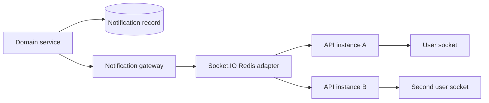
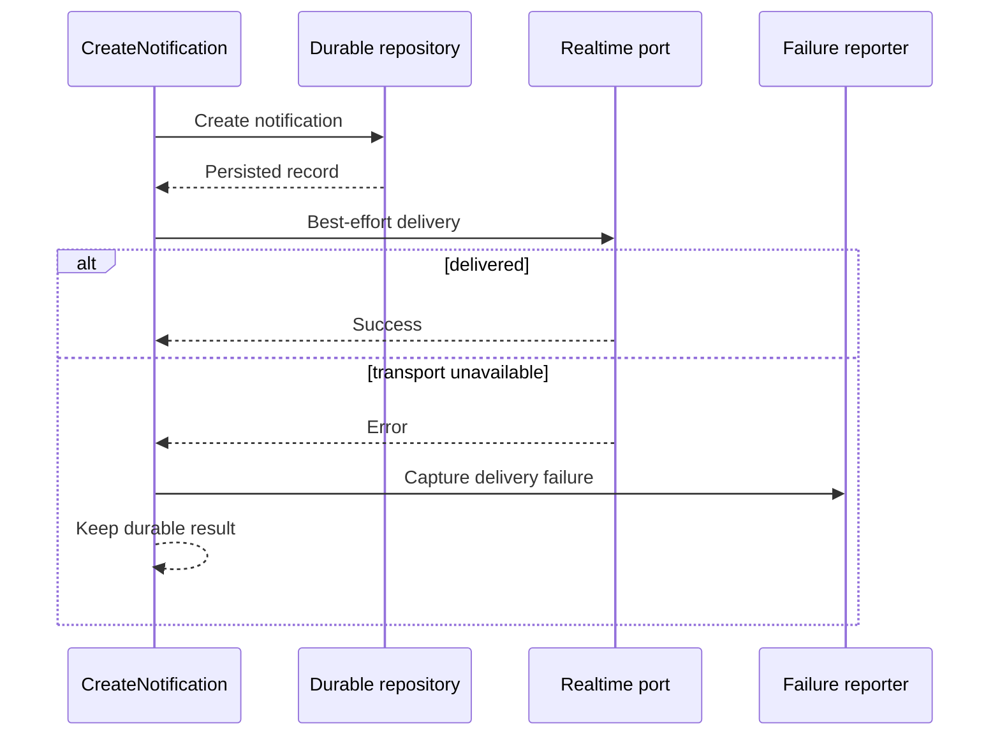

# Case Study: Redis-backed Realtime Notifications

## Problem

Reports, patient requests, security events, assignments, and clinical alerts can change while an administrator is online. Polling every list wastes resources, but an in-memory socket map fails as soon as the API runs on more than one instance.

## Implemented approach

The backend persists notification records and uses Socket.IO for immediate delivery. Socket handshakes validate an access token, and each accepted connection is stored in a Redis set keyed by user. A Redis adapter distributes socket events across API instances.

The connection protocol includes a `ready` acknowledgement before the socket is retained. The service emits new items, changed items, and unread/unseen counts. Delivery errors are isolated from the durable domain action so a temporary socket failure does not roll back a report or assignment.

Realtime can be replaced with a disabled gateway through module configuration, retaining the same service dependency when the feature is off.

## Public durable-first sample

The runnable `src/notifications` slice reduces the scenario to its essential guarantee:

Persistence failure remains fatal because no recoverable notification exists. Realtime failure is reported but returned as `DEFERRED`, allowing clients to recover through the persisted list after reconnecting.

## Trade-offs

- Socket delivery is advisory; the persisted notification list remains the recovery path.
- Connection sets require cleanup on disconnect and protection against stale entries.
- Token validation at connection time does not automatically revalidate a long-lived socket after role or session changes.
- Acknowledgement timeouts improve protocol clarity but require careful client compatibility.

## Engineering signal

The design separates durable notification state from best-effort realtime transport and supports horizontal API scaling.

Realtime is only one delivery plane. Background delivery has a different failure model and uses a PostgreSQL outbox, BullMQ workers, and Firebase as described in [Transactional push delivery](09-transactional-push-delivery.md). The browser-side boundary is covered in [Privacy-aware PWA and web push](10-privacy-aware-pwa.md).
