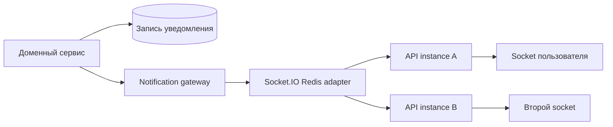
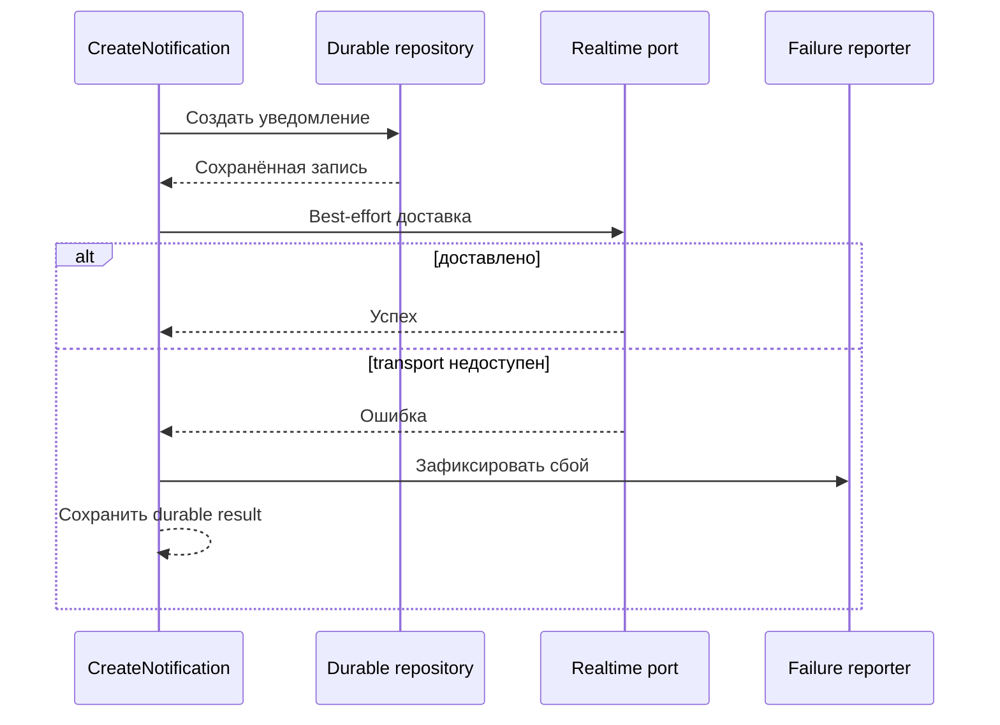

# Кейс: realtime-уведомления на Redis

[English](08-realtime-notifications.md) | [Русский]

## Проблема

Отчёты, запросы пациентов, события безопасности, назначения и клинические alerts меняются, пока администратор онлайн. Polling всех списков расходует ресурсы, а in-memory socket map перестаёт работать при нескольких API instances.

## Реализованный подход

Backend сохраняет notification records и использует Socket.IO для немедленной доставки. Handshake проверяет access token, подключение хранится в Redis set пользователя, а Redis adapter распространяет events между API instances.

Протокол включает acknowledgement `ready` до сохранения socket. Сервис отправляет новые и изменённые элементы, а также unread/unseen counts. Ошибки доставки изолированы от долговечного domain action: временный сбой socket не откатывает отчёт или назначение.

Через module configuration realtime заменяется disabled gateway с тем же service dependency.

## Публичный durable-first sample

Запускаемый slice `src/notifications` сводит сценарий к главной гарантии:

Persistence failure остаётся фатальным, потому что восстанавливаемого уведомления нет. Realtime failure регистрируется, но возвращается как `DEFERRED`: клиент восстановит данные из persisted list после reconnect.

## Компромиссы

- Socket delivery — advisory; persisted list остаётся recovery path.
- Connection sets требуют cleanup и защиты от stale entries.
- Проверка токена при подключении не перевалидирует long-lived socket после изменения роли или сессии.
- Acknowledgement timeouts улучшают протокол, но требуют совместимости клиента.

## Инженерный результат

Архитектура отделяет долговечное состояние уведомления от best-effort realtime transport и поддерживает горизонтальное масштабирование API.

Realtime — только один канал. Фоновая доставка использует PostgreSQL outbox, BullMQ и Firebase, как описано в [кейсе push-доставки](09-transactional-push-delivery.ru.md). Браузерная граница разобрана в [кейсе PWA и Web Push](10-privacy-aware-pwa.ru.md).
