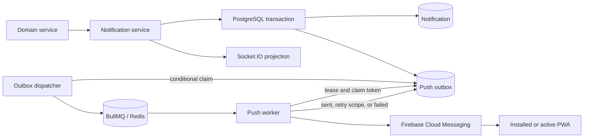
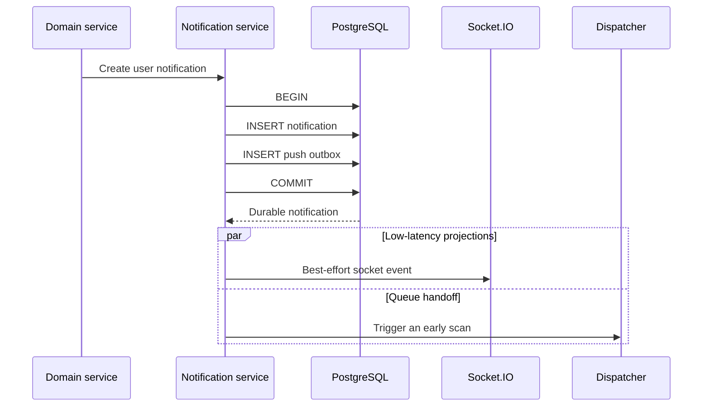
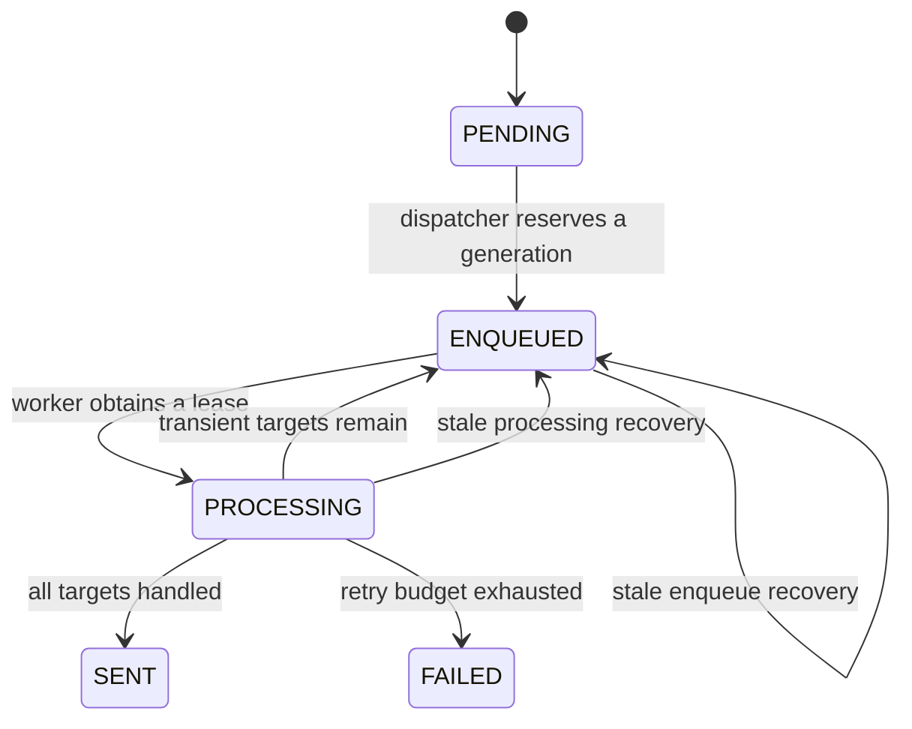
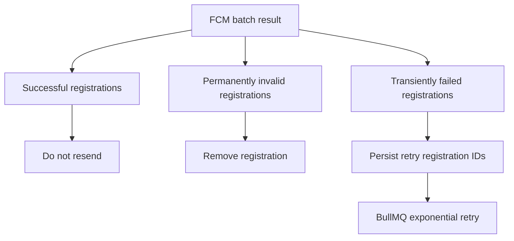
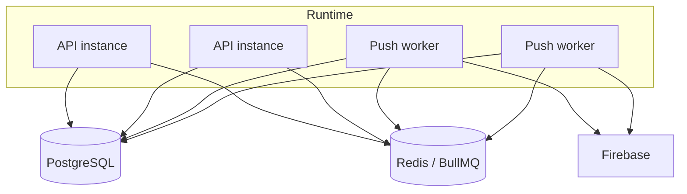

# Case Study: Transactional Push Delivery

## Problem

A domain event can be persisted successfully while an immediate call to a push provider or queue fails. Reversing the order only moves the inconsistency: a push may be sent for a notification that never committed.

For rehabilitation workflows, silent loss is worse than delayed delivery. The design therefore needs to preserve the intent to notify, move network work outside the request path, retry transient failures, and tolerate duplicate execution.

## Implemented approach

The notification record and a push outbox record are created in one PostgreSQL transaction. A dispatcher scans committed outbox work and publishes generation-specific jobs to BullMQ. A separate worker claims a job, loads the user's active browser registrations, and sends a privacy-safe data message through Firebase Cloud Messaging.

PostgreSQL is the source of truth for pending delivery. Redis is a fast queue transport, not the only copy of the work. If enqueueing fails or a retained queue job can no longer be reused, the dispatcher can recover the database row with a new generation.

## Atomic write path

If either insert fails, neither record commits. Realtime and queue handoff happen only after the durable transaction and cannot invalidate it.

## Delivery state machine

The concurrency controls have different jobs:

- an enqueue generation gives recovered work a fresh queue identity;
- a conditional database update prevents competing dispatchers from advancing the same row;
- a worker claim token prevents an old process from completing a newer attempt;
- a processing lease makes crashed work recoverable;
- completed and permanently failed rows are retained temporarily for diagnosis, then cleaned up.

## Target-scoped retries

Firebase returns a result per registration. A batch may contain successful targets, permanently invalid targets, and transient failures.

Only transiently failed registration identifiers are retained for the next attempt. This avoids resending to devices that already accepted the message. If an exception occurs before a new provider result exists, the previous narrowed retry scope is preserved.

## Privacy and idempotency

The push data intentionally avoids medical details. It carries a neutral title and body, a safe application URL, and an opaque delivery key. The same delivery key is used by the provider topic, the browser notification tag, and the foreground deduplication cache.

The system provides at-least-once processing, not an exactly-once claim. A provider can accept a message immediately before a network failure hides the response. Idempotent visual handling is therefore part of the end-to-end design rather than an optional UI improvement.

## Deployment topology

The same application image can start as an HTTP API or a non-HTTP worker. Production separates these processes so API scaling and delivery concurrency can be tuned independently. A serverless request handler alone is not a reliable BullMQ consumer.

## Failure model

| Failure | Result |
| --- | --- |
| Notification transaction fails | No notification and no outbox work exist. |
| Redis is temporarily unavailable | The outbox row remains recoverable in PostgreSQL. |
| Worker exits during delivery | The lease and stale recovery make the row eligible again. |
| One registration is invalid | That registration is removed; valid devices are not penalized. |
| Some targets fail transiently | Only the failed target identifiers enter the next attempt. |
| Repeated delivery reaches the browser | The delivery key suppresses duplicate presentation where possible. |

## Trade-offs

- The outbox adds schema, cleanup, monitoring, and operational complexity.
- At-least-once delivery still requires idempotency at the client boundary.
- Database polling adds bounded delay and query load, though an immediate best-effort scan reduces common-case latency.
- A critical medical event must remain visible in durable product state; push is a notification channel, not proof that a person acted.

## Engineering signal

The design closes the database-to-queue dual-write gap, separates low-latency transport from durable intent, and handles partial provider failure without broad duplicate delivery.

This public description omits production credentials, exact payload contracts, hostnames, and operational thresholds that would expose private deployment details.
