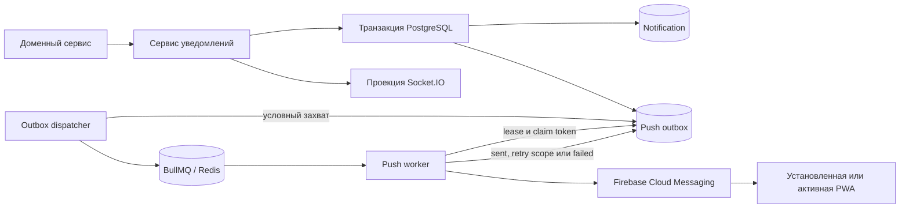
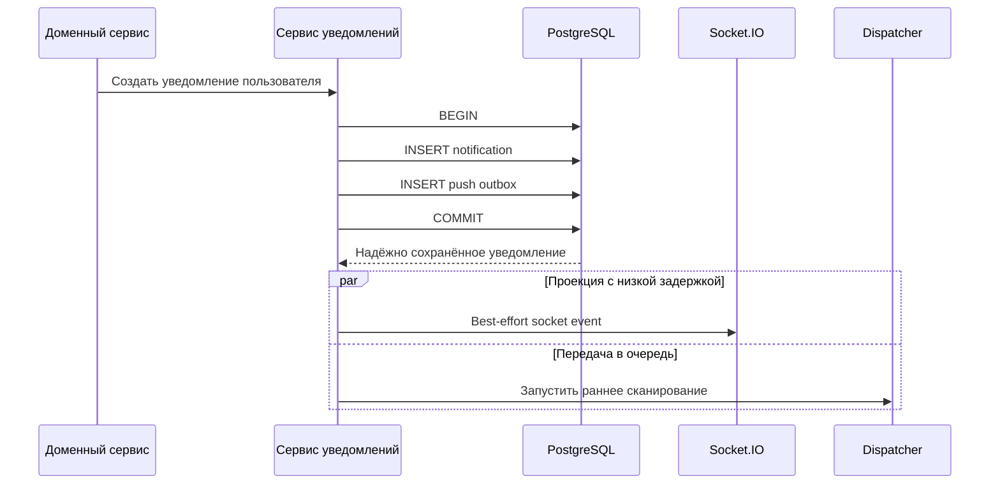
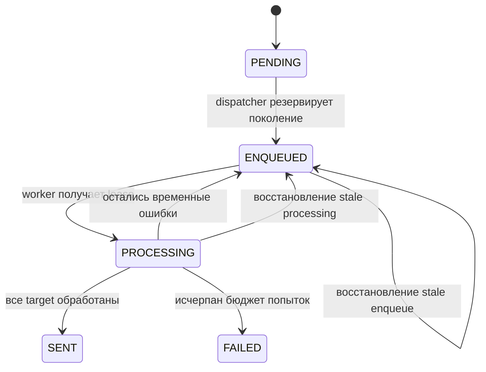
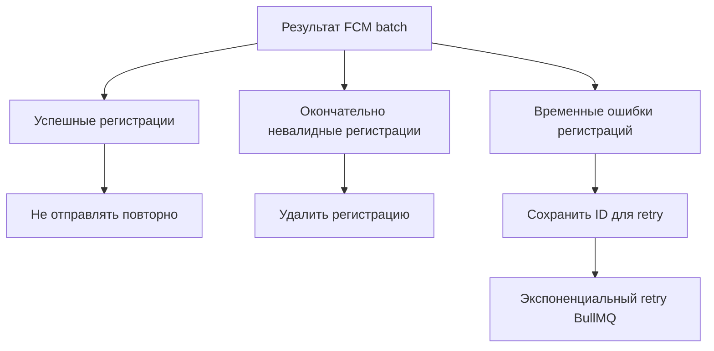
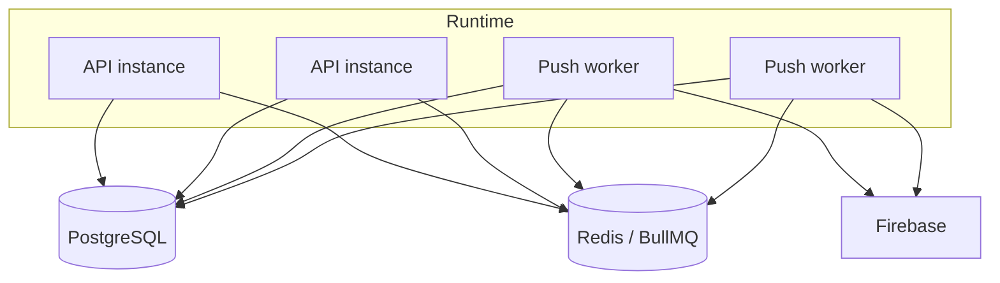

# Кейс: транзакционная доставка push-уведомлений

[English](09-transactional-push-delivery.md) | [Русский](09-transactional-push-delivery.ru.md)

## Проблема

Доменное событие может успешно сохраниться, а немедленный вызов push-провайдера или очереди — завершиться ошибкой. Если поменять порядок операций, противоречие лишь изменит форму: push может уйти для уведомления, которое так и не было зафиксировано в базе.

В реабилитационных сценариях незаметная потеря уведомления хуже задержки. Поэтому архитектура должна сохранять намерение отправить уведомление, выносить сетевую работу из HTTP-запроса, повторять временные ошибки и выдерживать повторное выполнение одной операции.

## Реализованный подход

Запись уведомления и запись push outbox создаются в одной транзакции PostgreSQL. Dispatcher сканирует подтверждённые записи outbox и публикует в BullMQ задания с отдельным поколением. Самостоятельный worker захватывает задание, загружает активные браузерные регистрации пользователя и отправляет через Firebase Cloud Messaging безопасное с точки зрения приватности data-сообщение.

PostgreSQL является источником истины для ожидающей доставки. Redis — быстрый транспорт очереди, но не единственная копия работы. Если enqueue завершается ошибкой или сохранённый job больше нельзя использовать повторно, dispatcher восстанавливает запись базы с новым поколением.

## Атомарный путь записи

Если любая из двух вставок завершается ошибкой, не фиксируется ни одна запись. Realtime-доставка и передача в очередь начинаются только после надёжной транзакции и не могут отменить её результат.

## Машина состояний доставки

Механизмы конкурентного доступа решают разные задачи:

- поколение enqueue даёт восстановленной работе новый идентификатор очереди;
- условное обновление базы не позволяет двум dispatcher одновременно продвинуть одну запись;
- claim token worker не позволяет старому процессу завершить более новую попытку;
- processing lease делает работу упавшего процесса восстанавливаемой;
- завершённые и окончательно неуспешные записи временно сохраняются для диагностики, а затем очищаются.

## Повтор только для нужных устройств

Firebase возвращает результат отдельно для каждой регистрации. В одном batch могут одновременно быть успешные target, окончательно невалидные target и временные ошибки.

Для следующей попытки сохраняются только идентификаторы регистраций с временными ошибками. Устройства, уже принявшие сообщение, не получают повторную отправку. Если исключение происходит до получения нового результата провайдера, ранее суженный набор retry сохраняется.

## Приватность и идемпотентность

Push-данные намеренно не содержат медицинских подробностей. В сообщение входят нейтральные заголовок и текст, безопасный URL приложения и непрозрачный ключ доставки. Один и тот же delivery key используется в topic провайдера, notification tag браузера и foreground-кэше дедупликации.

Система обеспечивает обработку «как минимум один раз» (`at-least-once`), а не строгую гарантию exactly-once. Провайдер может принять сообщение прямо перед сетевой ошибкой, скрывшей ответ. Поэтому идемпотентное визуальное отображение является частью сквозной архитектуры, а не необязательным улучшением интерфейса.

## Топология развёртывания

Один образ приложения может запускаться как HTTP API или как worker без HTTP listener. В production процессы разделяются, чтобы масштабирование API и конкурентность доставки настраивались независимо. Serverless request handler без отдельного постоянно работающего worker не является надёжным BullMQ consumer.

## Модель отказов

| Отказ | Результат |
| --- | --- |
| Транзакция уведомления не выполнена | Не существует ни уведомления, ни outbox-задания. |
| Redis временно недоступен | Запись outbox остаётся восстанавливаемой в PostgreSQL. |
| Worker завершается во время доставки | Lease и stale recovery снова делают запись доступной. |
| Одна регистрация невалидна | Регистрация удаляется, корректные устройства не затрагиваются. |
| Часть target завершается временной ошибкой | В следующую попытку попадают только их идентификаторы. |
| Повторная доставка дошла до браузера | Delivery key по возможности подавляет повторное отображение. |

## Компромиссы

- Outbox добавляет схему, очистку, мониторинг и эксплуатационную сложность.
- Доставка at-least-once всё равно требует идемпотентности на клиентской границе.
- Polling базы создаёт ограниченную задержку и нагрузку, хотя немедленное best-effort сканирование уменьшает задержку обычного сценария.
- Критическое медицинское событие должно оставаться видимым в надёжном состоянии продукта: push — канал уведомления, а не доказательство действия пользователя.

## Инженерный результат

Архитектура закрывает dual-write разрыв между базой и очередью, отделяет транспорт с низкой задержкой от надёжного намерения отправить сообщение и обрабатывает частичный отказ провайдера без массовой повторной доставки.

Публичное описание намеренно не раскрывает production credentials, точные контракты payload, адреса окружений и эксплуатационные пороги приватной инфраструктуры.
