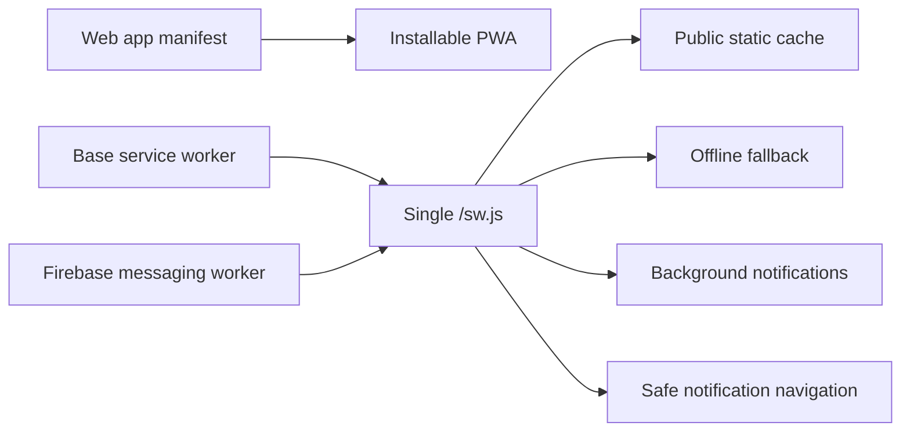
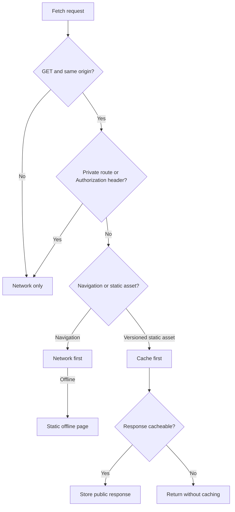
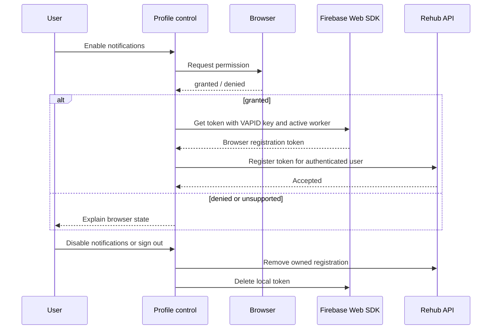
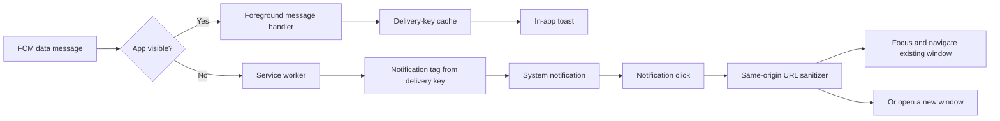
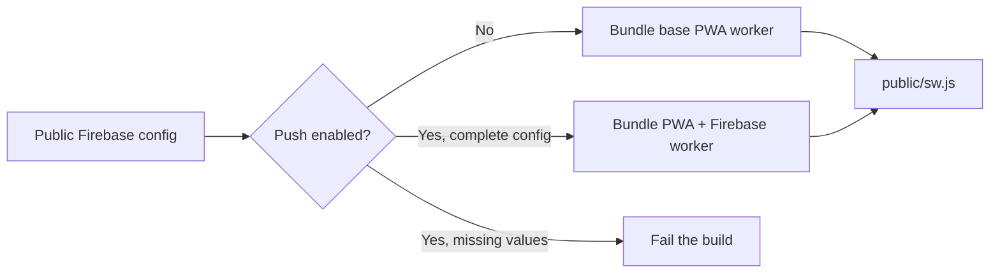

# Case Study: Privacy-aware PWA and Web Push

## Problem

Patients and doctors benefit from an installable application and timely notifications, but a conventional offline-first strategy can be unsafe for authenticated rehabilitation data. A service worker that indiscriminately caches pages or API responses may expose stale private information after logout or account switching.

The frontend also needs one coherent worker. Independent PWA and Firebase workers would compete for the same scope and create unpredictable install, update, cache, and push behavior.

## Implemented approach

The main Next.js application publishes a web manifest and builds one service worker from composable sources. The base worker owns install, activation, conservative caching, offline fallback, and notification clicks. When push is enabled at build time, the Firebase background handler is bundled into that same worker.

## Cache trust boundary

The application uses a narrow caching policy instead of treating every GET request as public.

Authenticated API requests and patient, doctor, authentication, and login routes bypass Cache Storage. Responses marked private or non-cacheable are not stored. This makes offline support deliberately modest: the app shell can explain network loss, but protected clinical screens are not replayed from a previous session.

## Permission and token lifecycle

Notification permission is requested only after an explicit user action in the doctor or patient profile. The application does not prompt on first page load.

Registration is idempotent and tied to the authenticated user. The token is resynchronized during later authenticated sessions because browsers and Firebase can rotate it. Logout remains available even when Firebase or the API is temporarily unreachable; local cleanup is still attempted.

## Foreground and background delivery

The background and foreground paths share the same neutral message semantics and delivery key. Notification clicks accept only a safe same-origin destination; malformed or external destinations fall back to the application root.

## Build-time configuration

The service worker is generated before development and production builds:

Client Firebase configuration and the VAPID public key are intentionally public build inputs. Firebase Admin credentials remain backend-only secrets and never enter the browser bundle.

## UX and platform behavior

- The manifest defines standalone display, application scope, theme colors, and regular/maskable icons.
- Service worker updates bypass HTTP cache to reduce stale worker deployments.
- Push support is feature-detected because browsers, private modes, device policies, and operating systems differ.
- Denied permission cannot be reversed by application code; the UI directs the user to browser settings.
- Web push requires HTTPS outside local development.
- Some mobile platforms require installation to the home screen before web push is available.

## Trade-offs

- Conservative caching provides less offline functionality but materially reduces privacy risk.
- Build-time Firebase configuration requires a rebuild when project settings change.
- Browser delivery cannot guarantee that the user saw or acted on a notification.
- Local deduplication reduces repeated presentation but does not turn the distributed pipeline into exactly-once delivery.

## Engineering signal

The PWA treats the service worker as a security boundary, not just a performance feature. Installation, offline behavior, push lifecycle, navigation safety, and backend delivery semantics are designed as one system.

The public case intentionally excludes production Firebase identifiers, private endpoints, credential material, and medical message content.
