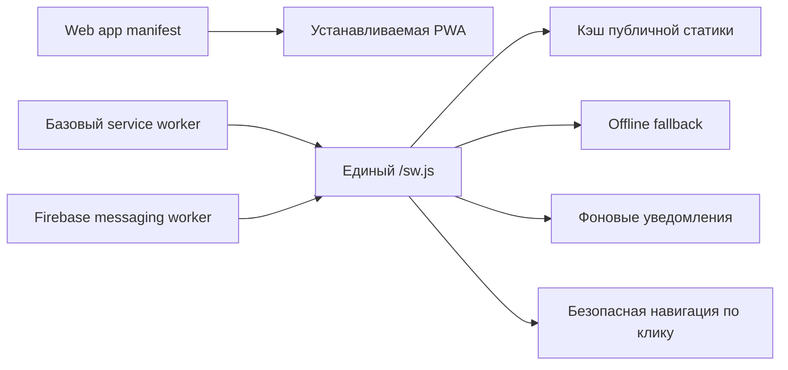
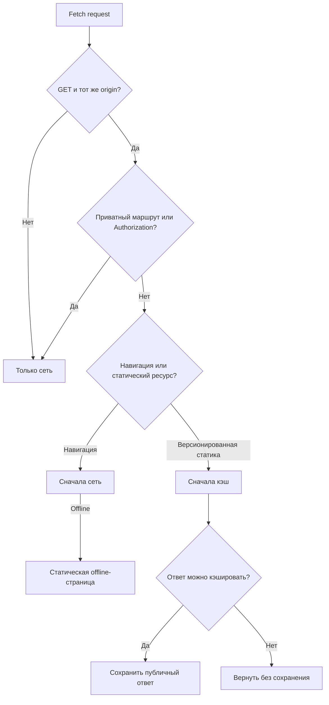
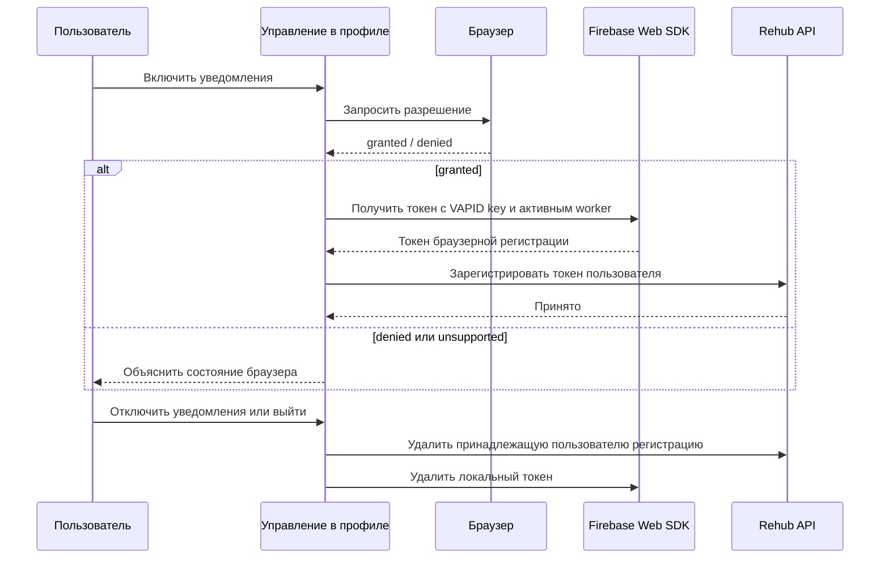
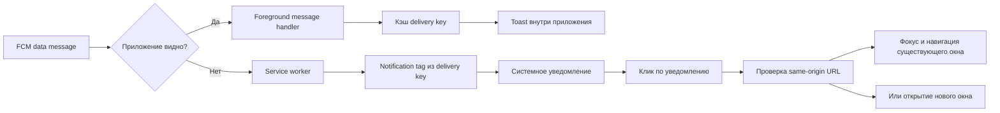
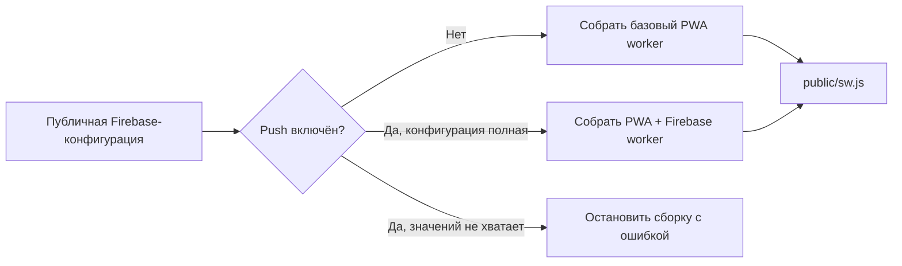

# Кейс: PWA и Web Push с учётом приватности

[English](10-privacy-aware-pwa.md) | [Русский](10-privacy-aware-pwa.ru.md)

## Проблема

Пациентам и врачам полезны устанавливаемое приложение и своевременные уведомления, однако обычная offline-first стратегия может быть небезопасна для авторизованных реабилитационных данных. Service worker, без разбора кэширующий страницы или API-ответы, способен показать устаревшую приватную информацию после выхода или смены аккаунта.

Frontend также нуждается в одном согласованном worker. Независимые PWA- и Firebase-worker конкурировали бы за один scope и создавали непредсказуемое поведение установки, обновления, кэша и push.

## Реализованный подход

Основное Next.js-приложение публикует web manifest и собирает единый service worker из составных частей. Базовый worker отвечает за установку, активацию, консервативное кэширование, offline fallback и клики по уведомлениям. Когда push включён во время сборки, Firebase background handler добавляется в тот же worker.

## Граница доверия кэша

Приложение применяет узкую политику кэширования, а не считает публичным каждый GET-запрос.

Авторизованные API-запросы, маршруты пациента, врача, аутентификации и входа обходят Cache Storage. Ответы с признаками `private` или запрета кэширования не сохраняются. Offline-поддержка намеренно ограничена: оболочка приложения объясняет потерю сети, но защищённые клинические экраны не воспроизводятся из предыдущей сессии.

## Жизненный цикл permission и токена

Разрешение на уведомления запрашивается только после явного действия пользователя в профиле врача или пациента. При первой загрузке страницы автоматического запроса нет.

Регистрация идемпотентна и связана с авторизованным пользователем. Во время следующих авторизованных сессий токен синхронизируется повторно, поскольку браузер и Firebase могут его ротировать. Выход остаётся доступным даже при временной недоступности Firebase или API; приложение всё равно пытается выполнить локальную очистку.

## Доставка в foreground и background

Foreground- и background-пути используют одинаковую нейтральную семантику сообщения и общий delivery key. Клик по уведомлению принимает только безопасный same-origin адрес; некорректные или внешние назначения заменяются корнем приложения.

## Конфигурация во время сборки

Service worker генерируется перед development- и production-сборками:

Клиентская Firebase-конфигурация и публичный VAPID key являются открытыми входными данными сборки. Firebase Admin credentials остаются секретами backend и никогда не попадают в browser bundle.

## UX и поведение платформ

- Manifest задаёт standalone display, scope приложения, цвета темы, обычные и maskable-иконки.
- Обновление service worker обходит HTTP cache, снижая риск доставки устаревшего worker.
- Поддержка push определяется во время выполнения, потому что браузеры, приватные режимы, политики устройств и операционные системы отличаются.
- Отказ в permission нельзя отменить кодом приложения; интерфейс направляет пользователя в настройки браузера.
- За пределами локальной разработки Web Push требует HTTPS.
- На части мобильных платформ Web Push доступен только после установки приложения на домашний экран.

## Компромиссы

- Консервативное кэширование даёт меньше offline-возможностей, но существенно снижает риск утечки приватных данных.
- Build-time Firebase-конфигурация требует новой сборки при изменении параметров проекта.
- Доставка в браузер не гарантирует, что пользователь увидел уведомление или выполнил действие.
- Локальная дедупликация уменьшает повторное отображение, но не превращает распределённый pipeline в exactly-once доставку.

## Инженерный результат

PWA рассматривает service worker как границу безопасности, а не только как средство ускорения. Установка, offline-поведение, жизненный цикл push, безопасность навигации и backend-семантика доставки спроектированы как единая система.

Публичный кейс намеренно исключает production Firebase identifiers, приватные endpoints, credential material и медицинское содержимое сообщений.
