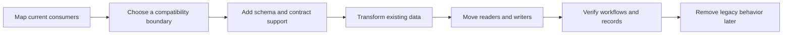
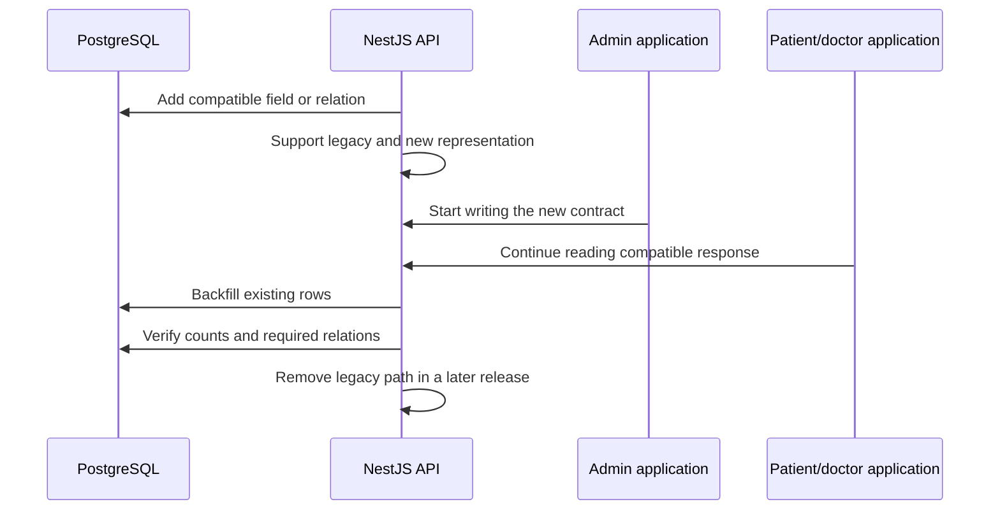

# Case Study: Brownfield Maintenance and Safe Migrations

[English](11-brownfield-maintenance-and-safe-migrations.md) | [Русский](11-brownfield-maintenance-and-safe-migrations.ru.md)

## Problem

Rehub grew from a graduation project into a multi-role rehabilitation platform. Its backend, patient/doctor application, and admin panel did not all evolve at the same speed. Newer domain modules coexist with older DTO shapes, mock-backed screens, integration code, and operational assumptions created earlier in the project.

In this environment, maintenance is not a one-time rewrite. A safe change must preserve existing patient, doctor, and administrator workflows while moving database state, API contracts, frontend readers, seeds, and documentation toward a clearer model.

## Maintenance model

The project uses an incremental brownfield loop:

### Map consumers before changing the model

A backend field may be consumed by the main web application, admin forms, exports, PDF generation, notifications, analytics, seeds, and internal jobs. The first step is therefore a usage map rather than editing the Prisma schema in isolation.

The review covers durable database ownership, API request and response DTOs, admin and patient/doctor query hooks, export and report projections, seed assumptions, and background side effects.

### Use transitional contracts

When a representation changes, the backend temporarily accepts or produces a compatible form while clients move independently. New fields are added before old fields disappear. Frontend runtime schemas make the transition visible: a mismatch fails at the data boundary instead of surfacing later as a broken component.

### Keep data transformation explicit

Structural Prisma migrations and data transformations solve different problems. Schema changes remain ordered SQL artifacts. Data changes use explicit SQL or scripts that can define defaults, preserve relationships, and report unexpected rows.

Representative evolution in the private project has included:

- turning previously simple content into structured steps;
- adding patient and doctor attributes while keeping existing profiles valid;
- expanding program-template relationships without invalidating active assignments;
- introducing notification and outbox persistence alongside existing realtime behavior;
- evolving reporting and analytics projections as the domain became richer.

The public case study describes the migration method, not private table names or medical data.

## Expand–migrate–contract example

This sequencing prevents a frontend deployment from becoming an implicit database migration and gives each surface an independent rollback point.

## Seeds are migration consumers

Seeds are treated as executable examples of the current domain, not disposable setup code. When a required field or relation changes, representative seeds must move with the schema. Otherwise a clean environment can pass migration deployment and still fail during onboarding, development, or demonstration.

The same rule applies to generated documents and test fixtures: they are downstream consumers of the domain contract.

## Recovery strategy

| Change type | Recovery approach |
| --- | --- |
| Additive field or table | Roll back application code if necessary; retain the compatible schema. |
| Data backfill | Make the operation restartable, record progress, and reconcile counts before enabling constraints. |
| Relationship change | Preserve old identifiers until all readers use the new relation and orphan checks pass. |
| Destructive cleanup | Take a verified backup and perform cleanup only after the compatibility window closes. |
| Cross-surface contract regression | Restore the previous API/client combination or re-enable the transitional adapter. |

Application rollback and data recovery are separate decisions. Reverting a container image cannot recover deleted rows or reverse an irreversible transformation.

## Quality evidence

At the time of review, the private Rehub codebase contained:

- 47 ordered SQL migration files across the evolving domain;
- approximately 500 backend TypeScript files and 28 backend test files;
- more than 1,100 TypeScript/TSX files across the two frontend surfaces;
- frontend tests for critical utilities and application behavior;
- public vertical slices with 18 passing tests and coverage above 90%;
- separate migration, API, admin, and main-web container builds.

These are review-time signals, not permanent totals. Exact schema definitions, private contracts, patient data, and deployment configuration remain unpublished.

## Known limitations and next hardening

- Test density is uneven across older and newer modules.
- The current migrator workflow builds a migration image but does not yet apply the full history to a clean PostgreSQL service in CI.
- Some frontend surfaces still contain both mock-backed and live API paths.
- Large route components and older integration boundaries should be modernized incrementally rather than through a risky rewrite.
- Production-sized migration timing, locks, and rollback recovery need environment-specific rehearsal.

The highest-value next step is to add a fresh-database migration job before building the migrator image, matching the stronger validation already used in TraceAxios.

## Engineering signal

This case demonstrates maintenance judgment: discovering consumers before changing contracts, separating schema from data migration, preserving compatibility across independently deployed surfaces, and making technical debt explicit instead of hiding it behind a rewrite proposal.
