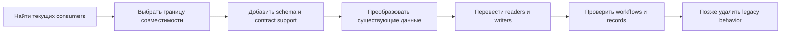
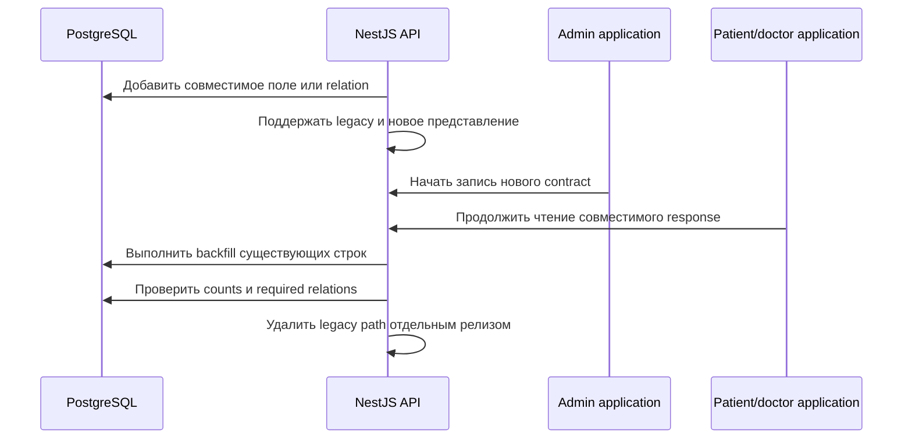

# Кейс: сопровождение brownfield-системы и безопасные миграции

[English](11-brownfield-maintenance-and-safe-migrations.md) | [Русский](11-brownfield-maintenance-and-safe-migrations.ru.md)

## Проблема

Rehub вырос из выпускного проекта в много-ролевую платформу реабилитации. Backend, приложение пациента/врача и admin panel развивались с разной скоростью. Новые доменные модули сосуществуют со старыми DTO, mock-backed экранами, интеграционным кодом и операционными допущениями ранних этапов.

В такой системе сопровождение — не одноразовый rewrite. Безопасное изменение должно сохранять существующие сценарии пациентов, врачей и администраторов, одновременно переводя database state, API contracts, frontend readers, seeds и документацию к более ясной модели.

## Модель сопровождения

Используется инкрементальный brownfield-цикл:

### Сначала карта consumers

Поле backend может использоваться в основном web-приложении, admin forms, exports, PDF generation, notifications, analytics, seeds и внутренних jobs. Поэтому работа начинается с usage map, а не с изолированного редактирования Prisma schema.

Проверяются durable database ownership, request/response DTO, query hooks admin и patient/doctor приложений, export и report projections, seed assumptions и background side effects.

### Transitional contracts

При смене представления backend временно принимает или возвращает совместимую форму, пока клиенты обновляются независимо. Новые поля добавляются до удаления старых. Runtime schemas на frontend делают переход наблюдаемым: несовпадение останавливается на data boundary, а не проявляется позже сломанным компонентом.

### Явное преобразование данных

Структурные Prisma migrations и data transformations решают разные задачи. Изменения schema остаются упорядоченными SQL-артефактами. Изменения данных выполняются явным SQL или scripts, которые задают defaults, сохраняют relationships и сообщают о неожиданных строках.

Примеры эволюции приватного проекта:

- преобразование простого контента в структурированные шаги;
- добавление атрибутов пациентов и врачей с сохранением валидности старых профилей;
- расширение связей program templates без поломки активных assignments;
- добавление notification и outbox persistence рядом с существующим realtime-поведением;
- развитие report и analytics projections вместе с усложнением домена.

Публичный кейс описывает метод миграции, но не раскрывает названия приватных таблиц или медицинские данные.

## Пример expand–migrate–contract

Такой порядок не превращает frontend deploy в скрытую database migration и даёт каждой поверхности независимую точку rollback.

## Seeds как consumers миграции

Seeds рассматриваются как исполняемые примеры текущего домена, а не одноразовый setup code. Когда меняется required field или relation, representative seeds должны обновляться вместе со schema. Иначе чистое окружение может успешно применить миграции, но упасть при onboarding, разработке или демонстрации.

То же правило относится к generated documents и test fixtures: они являются downstream consumers доменного контракта.

## Стратегия восстановления

| Тип изменения | Подход к восстановлению |
| --- | --- |
| Additive field или table | При необходимости откатить application code, сохранив совместимую schema. |
| Data backfill | Сделать операцию restartable, фиксировать прогресс и сверять counts до включения constraints. |
| Изменение relationship | Сохранять старые identifiers, пока все readers не перейдут на новую связь и не пройдут orphan checks. |
| Destructive cleanup | Сделать проверенный backup и удалять данные только после закрытия compatibility window. |
| Регрессия cross-surface contract | Восстановить предыдущую пару API/client или вернуть transitional adapter. |

Application rollback и data recovery — разные решения. Откат container image не восстановит удалённые строки и не обратит необратимое преобразование.

## Доказательства качества

На момент review приватная кодовая база Rehub содержала:

- 47 последовательных SQL migration-файлов;
- около 500 backend TypeScript-файлов и 28 backend test-файлов;
- более 1 100 TypeScript/TSX-файлов в двух frontend-приложениях;
- frontend tests для критических utilities и application behavior;
- публичные vertical slices с 18 проходящими тестами и coverage выше 90%;
- отдельные container builds для migrations, API, admin и main web.

Это сигналы на дату review, а не постоянные totals. Точные schema definitions, приватные contracts, данные пациентов и deployment configuration не публикуются.

## Известные ограничения и дальнейшее усиление

- Test density неравномерна между старыми и новыми модулями.
- Текущий migrator workflow собирает migration image, но пока не применяет полную историю к чистому PostgreSQL в CI.
- В отдельных frontend surfaces продолжают сосуществовать mock-backed и live API paths.
- Большие route components и старые integration boundaries следует модернизировать постепенно, без рискованного rewrite.
- Migration timing, locks и rollback recovery на production-size данных требуют отдельной репетиции окружения.

Самый ценный следующий шаг — добавить fresh-database migration job до сборки migrator image, по аналогии с более сильной проверкой в TraceAxios.

## Инженерный сигнал

Кейс демонстрирует зрелое сопровождение: поиск consumers до изменения contracts, разделение schema и data migration, совместимость независимо разворачиваемых surfaces и явное управление technical debt вместо маскировки его предложением полного rewrite.
