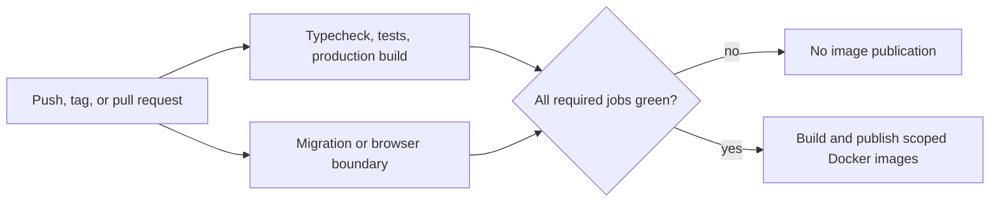

# Production Quality Gates Across Three Repositories

[Русская версия](12-production-quality-gates.ru.md)

## Problem

Rehub is delivered from three private repositories with different failure modes. The NestJS backend owns database migrations and runtime images. The main Next.js application owns patient and doctor journeys. The admin application owns operational workflows and still supports deterministic mock-backed development. A single generic `build` check would not provide useful release evidence for all three.

The goal was to make the highest-risk boundary of each repository executable in CI while keeping production source and infrastructure details private.

## Pipeline shape

Pull requests exercise the gates without publishing images. Push and version-tag runs may publish only after their required jobs succeed. Concurrency cancellation prevents an obsolete run from continuing after a newer commit arrives, and third-party GitHub Actions are pinned to immutable commit SHAs.

## Backend: migration safety is a release gate

The backend quality job installs from the lockfile, generates the Prisma client, type-checks, runs tests with coverage, and builds the NestJS application. A separate job starts a clean PostgreSQL 16 service, applies the complete Prisma migration history, and verifies the resulting migration state.

Both jobs must succeed before the reusable Docker workflow builds the three independently operated artifacts:

- the API image;
- the migration image;
- the Prisma Studio image.

This catches a class of failure that unit tests cannot: a migration chain that works against a developer's existing database but cannot bootstrap a fresh environment.

## Main web: browser-visible contracts

The main web pipeline separates fast code checks from browser behavior. Its quality job runs TypeScript, 43 unit and contract tests, and a production Next.js build. A parallel Playwright job exercises 7 Chromium scenarios covering:

- anonymous patient and doctor route protection, including the login callback;
- login validation and password recovery;
- the custom not-found experience;
- manifest, offline, and service-worker contracts at the PWA boundary.

Stage and production images depend on both jobs. The browser suite stores JUnit output, an HTML report, traces, screenshots, and video when available, so a CI failure leaves evidence instead of only a terminal message.

## Admin: a hermetic critical path

The admin pipeline runs TypeScript, 16 unit tests, a production build, and 5 Chromium scenarios. The E2E path covers protected-route redirection, invalid-email validation, password recovery, authenticated dashboard loading, exercise search, and opening the exercise creation flow.

The suite is hermetic: browser-side API traffic is handled by the application's existing MSW contracts, while a small test server handles the server-action boundary used during authentication. It therefore verifies the admin UI without requiring a shared staging backend or reusable credentials.

The exercise queries were also moved through the existing browser client service rather than importing server-only services into React Query hooks. This made the production boundary and the test boundary agree instead of adding an E2E-only shortcut.

## Failure policy and diagnostics

The pipelines use the same operating rules:

- deployable Docker artifacts cannot be published before their repository-specific quality gates pass;
- pull requests validate images or application builds without publishing release artifacts;
- unit and browser reports are uploaded even when a test step fails;
- frontend E2E uses an explicit, small worker count to favor deterministic evidence over nominal parallel speed;
- GitHub Environments keep stage and production publication scopes separate.

## Evidence snapshot and limits

The counts below were verified on 2026-10-26:

| Repository | Automated evidence |
| --- | --- |
| Backend | 73 tests in 29 suites; clean-PostgreSQL migration smoke test; application build. |
| Main web | 43 unit/contract tests; 7 Playwright scenarios; production build. |
| Admin | 16 unit tests; 5 Playwright scenarios; production build. |

These numbers are a point-in-time verification aid, not a platform-wide coverage percentage or a claim that every product path is automated. The private workflows, source, secrets, image names, and deployment configuration remain outside this showcase. The public repository has its own smaller `npm run check` gate so the code that is actually disclosed can be verified independently.
