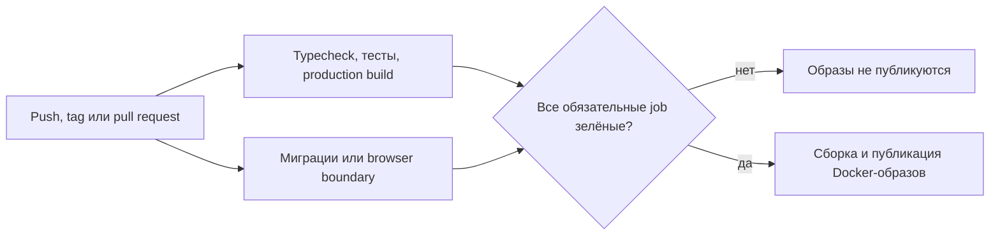

# Production quality gates для трёх репозиториев

[English version](12-production-quality-gates.md)

## Задача

Rehub поставляется из трёх приватных репозиториев с разными рисками. NestJS backend отвечает за миграции базы и runtime-образы. Основное Next.js-приложение реализует сценарии пациента и врача. Admin-приложение покрывает операционные процессы и сохраняет возможность детерминированной разработки на mock-контрактах. Одна общая проверка `build` не дала бы достаточных release evidence для всех трёх частей.

Цель — сделать наиболее рискованную границу каждого репозитория исполняемой в CI, не раскрывая production-код и детали инфраструктуры.

## Схема pipeline

Pull request проходит все проверки, но не публикует образы. Запуск по push или version tag может публиковать их только после успешных обязательных job. Concurrency cancellation останавливает устаревший run после появления нового commit, а сторонние GitHub Actions закреплены по неизменяемым commit SHA.

## Backend: безопасность миграций как release gate

Backend quality job устанавливает зависимости из lockfile, генерирует Prisma Client, выполняет typecheck, запускает тесты с coverage и собирает NestJS-приложение. Отдельная job поднимает чистый PostgreSQL 16, применяет всю историю Prisma-миграций и проверяет итоговый migration state.

Обе job должны завершиться успешно до запуска переиспользуемого Docker workflow, который собирает три независимо используемых артефакта:

- API image;
- migration image;
- Prisma Studio image.

Так обнаруживается класс ошибок, который не виден unit-тестам: цепочка миграций работает на уже существующей базе разработчика, но не может развернуть новое окружение с нуля.

## Основной web: контракты, видимые в браузере

Pipeline основного web разделяет быстрые проверки кода и браузерное поведение. Quality job запускает TypeScript, 43 unit/contract-теста и production build Next.js. Параллельная Playwright job выполняет 7 Chromium-сценариев:

- защита patient- и doctor-маршрутов для анонимного пользователя с сохранением login callback;
- валидация входа и восстановление пароля;
- собственная not-found страница;
- контракты manifest, offline и service worker на PWA-границе.

Stage- и production-образы зависят от обеих job. Browser suite сохраняет JUnit, HTML-отчёт, traces, screenshots и video, когда они доступны, поэтому после сбоя CI остаются диагностические материалы, а не только строка в терминале.

## Admin: герметичный critical path

Admin pipeline запускает TypeScript, 16 unit-тестов, production build и 5 Chromium-сценариев. E2E проверяет redirect защищённого маршрута, валидацию некорректного email, восстановление пароля, загрузку dashboard после входа, поиск упражнения и открытие формы создания упражнения.

Набор тестов герметичен: запросы из браузера обрабатываются существующими MSW-контрактами приложения, а небольшой test server обслуживает server-action границу авторизации. Для проверки admin UI не нужны общий staging backend и переиспользуемые учётные данные.

Exercise queries также переведены на существующий browser client service вместо импорта server-only сервисов в React Query hooks. Поэтому production-граница совпадает с тестовой, без специального E2E-обхода.

## Политика сбоев и диагностика

Во всех pipeline действуют общие правила:

- deployable Docker-артефакты не публикуются до успешного прохождения специфичных для репозитория quality gates;
- pull request проверяет сборку приложения или образов без публикации release-артефактов;
- unit- и browser-отчёты загружаются даже при падении тестового шага;
- frontend E2E использует явно заданное небольшое число workers, отдавая приоритет детерминированности перед номинальной скоростью;
- GitHub Environments разделяют stage- и production-контуры публикации.

## Снимок evidence и ограничения

Числа проверены 26 октября 2026 года:

| Репозиторий | Автоматизированные evidence |
| --- | --- |
| Backend | 73 теста в 29 suites; migration smoke test на чистом PostgreSQL; сборка приложения. |
| Основной web | 43 unit/contract-теста; 7 Playwright-сценариев; production build. |
| Admin | 16 unit-тестов; 5 Playwright-сценариев; production build. |

Это датированный проверочный снимок, а не общий процент покрытия платформы и не утверждение, что автоматизирован каждый пользовательский путь. Приватные workflow, исходный код, secrets, имена образов и deployment-конфигурация остаются за границами витрины. У публичного репозитория есть собственный небольшой gate `npm run check`, поэтому опубликованный код можно проверить независимо.
