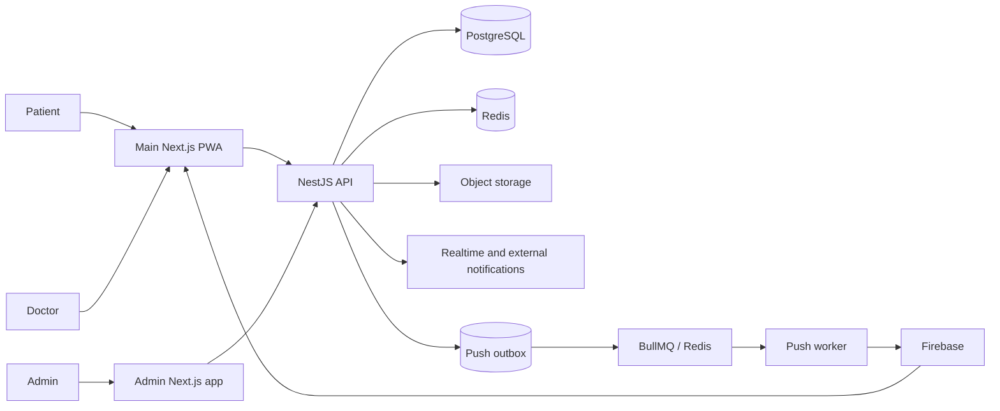

# Rehub Engineering Case Studies

These notes were reconstructed from a focused review of the private Rehub backend, main web application, admin panel, and technical documentation. They explain implemented behavior without copying production source or exposing sensitive contracts.

## System map

## Deep dives

1. Role-oriented platform boundaries — [EN](01-role-oriented-platform.md) · [RU](01-role-oriented-platform.ru.md)
2. Rehabilitation program lifecycle — [EN](02-rehabilitation-program-lifecycle.md) · [RU](02-rehabilitation-program-lifecycle.ru.md)
3. Diary and progress projections — [EN](03-diary-and-progress.md) · [RU](03-diary-and-progress.ru.md)
4. Clinical policies and event lifecycles — [EN](04-clinical-policies.md) · [RU](04-clinical-policies.ru.md)
5. Login audit and IP throttling — [EN](05-login-audit-and-ip-throttling.md) · [RU](05-login-audit-and-ip-throttling.ru.md)
6. Reports, exports, and side effects — [EN](06-reports-and-exports.md) · [RU](06-reports-and-exports.ru.md)
7. Contract-first mock-to-API migration — [EN](07-contract-first-frontend.md) · [RU](07-contract-first-frontend.ru.md)
8. Redis-backed realtime notifications — [EN](08-realtime-notifications.md) · [RU](08-realtime-notifications.ru.md)
9. Transactional push delivery — [EN](09-transactional-push-delivery.md) · [RU](09-transactional-push-delivery.ru.md)
10. Privacy-aware PWA and web push — [EN](10-privacy-aware-pwa.md) · [RU](10-privacy-aware-pwa.ru.md)
11. Brownfield maintenance and safe migrations — [EN](11-brownfield-maintenance-and-safe-migrations.md) · [RU](11-brownfield-maintenance-and-safe-migrations.ru.md)

## Reading rule

Each case distinguishes what exists in the private project from what is simplified in the public sample. Known limitations are part of the analysis rather than hidden from it.

## Related evidence and decisions

- [Testing strategy](../testing.md)
- [Separate durable audit from expiring throttle state](../decisions/001-separate-audit-and-throttle-state.md)
- [Durable notifications with realtime transport](../decisions/002-durable-notifications-with-realtime-transport.md)
