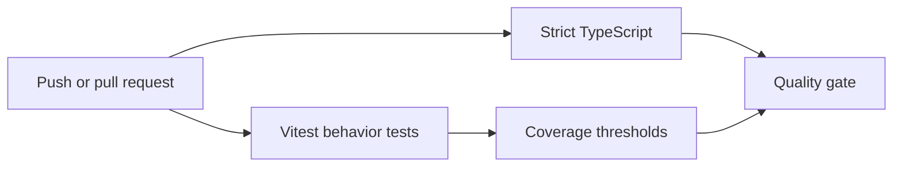

# Testing and Delivery

## Private project reality

The repositories evolved at different speeds. The backend contains unit tests and an end-to-end setup, while frontend automation and coverage are not uniform across every application. This showcase does not claim a platform-wide coverage number.

## Public sample quality gate

The sample is deliberately small enough to verify completely:



Tests cover externally visible behavior:

- every failed attempt creates an audit event;
- the configured threshold creates a temporary block;
- the block expires according to TTL;
- successful authentication resets failed-attempt state;
- a successful event retains a safe actor snapshot.

The adapters are in-memory test doubles. Production-oriented ports would be implemented with a durable audit repository and an atomic Redis counter operation.

## Commands

```bash
npm run typecheck
npm test
npm run test:coverage
npm run check
```
