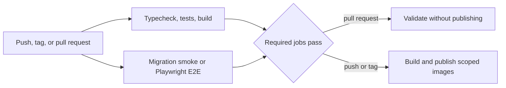
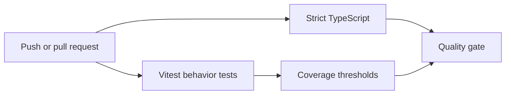

# Testing and Delivery

## Current verification snapshot

Every deployable repository has an automated GitHub Actions gate. The depth differs by surface because the failure modes differ; this showcase does not claim one platform-wide coverage number.

Counts were verified on 2026-10-26:

| Surface | Fast feedback | Boundary test | Publish rule |
| --- | --- | --- | --- |
| Backend | TypeScript, 73 tests in 29 suites, coverage, NestJS build | Complete Prisma history applied to clean PostgreSQL 16 | API, migration, and Prisma Studio images require quality and migration jobs. |
| Main web | TypeScript, 43 unit/contract tests, Next.js production build | 7 Playwright Chromium scenarios | Stage and production images require quality and E2E jobs. |
| Admin | TypeScript, 16 unit tests, Next.js production build | 5 Playwright Chromium scenarios | Stage and production images require quality and E2E jobs. |



## Backend boundary

The unit suite covers service and policy behavior. CI separately creates a clean PostgreSQL 16 service, deploys the complete Prisma migration history, and checks migration status. This makes clean-environment bootstrap a release condition rather than an operator assumption.

## Browser boundaries

The main web suite covers anonymous doctor and patient route protection, callback preservation, login validation, password recovery, custom not-found behavior, and PWA manifest/offline/service-worker contracts.

The admin suite covers protected-route redirection, login validation, password recovery, authenticated dashboard data, exercise search, and the entry point for creating an exercise. Browser API calls use the application's MSW contracts, while a small local test server supplies the server-action auth boundary. No shared staging account or external backend is required.

Both frontend pipelines retain JUnit and HTML reports plus Playwright traces, screenshots, and video when produced. A deliberately small worker count reduces shared-process and authentication flakiness.

## Delivery controls

- Docker publication depends on the repository-specific quality and boundary jobs.
- Pull requests run verification without publishing images.
- Stage and production targets use separate GitHub Environments.
- Obsolete runs are cancelled when a newer commit arrives on the same ref.
- Third-party Actions are pinned to immutable commit SHAs.
- Diagnostic artifacts are uploaded even when test execution fails.

For the rationale and repository-by-repository design, read [Production quality gates](case-studies/12-production-quality-gates.md) ([RU](case-studies/12-production-quality-gates.ru.md)).

## Public sample quality gate

The disclosed sample is deliberately small enough to verify completely:



Its tests verify that:

- every failed login creates an audit event;
- the configured threshold creates a temporary block;
- the block expires according to TTL;
- successful authentication resets failed-attempt state;
- red-flag operators produce deterministic candidates;
- inactive, unrelated, expired, and future measurements are ignored;
- cooldown suppresses repeated candidates;
- notifications are persisted before realtime delivery;
- realtime failure preserves the durable result and is reported;
- persistence failure prevents an invalid realtime event.

The adapters are in-memory test doubles. Production-oriented ports use durable repositories, atomic Redis operations, and an authenticated Socket.IO gateway.

## Public commands

```bash
npm run typecheck
npm test
npm run test:coverage
npm run check
```

The exact private implementation, CI secrets, registry paths, and deployment manifests are intentionally not published. Test counts are a dated evidence snapshot and will change as the product evolves.
