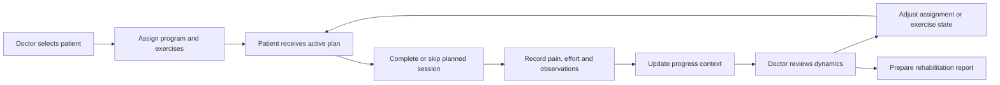
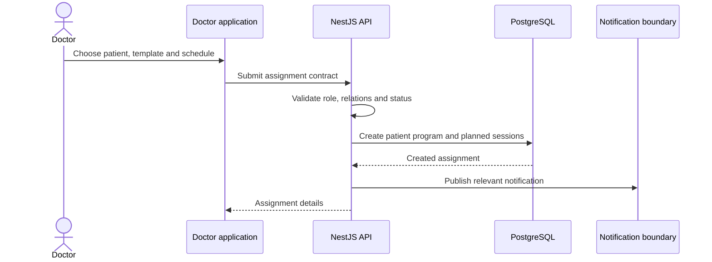
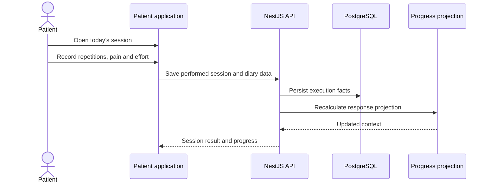
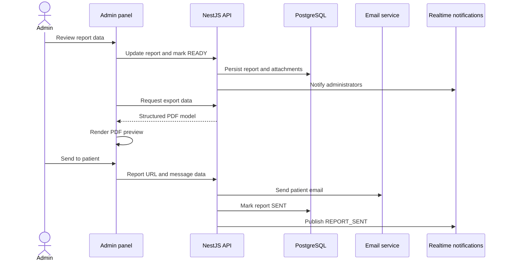

# Role-oriented User Flows

## Rehabilitation loop

## Doctor assigns a program

## Patient completes a session

## Administrator prepares and sends a report

## Scope enforcement

The UI adapts navigation to role and permissions, but the backend remains the authorization boundary. Doctor and patient operations are scoped to the authenticated actor and their relations; administrative endpoints apply explicit role or permission guards.
